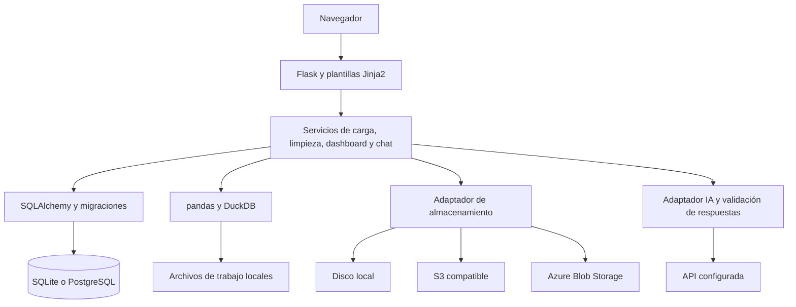
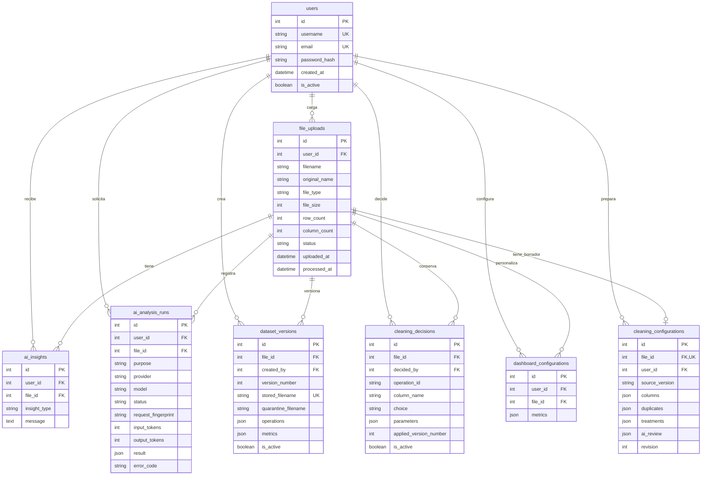

<div align="center">


# CoDataU

**Preparación, limpieza y análisis de datos con asistencia de inteligencia artificial**

Proyecto académico · Prototipo funcional

</div>

CoDataU permite cargar archivos CSV o Excel, revisar su calidad, configurar su limpieza y analizar los resultados desde el navegador. Está pensado para personas que necesitan trabajar con información sin escribir consultas ni programar transformaciones.

La limpieza combina reglas predefinidas con IA para los casos que requieren interpretación. El usuario revisa propuestas y confirma los cambios antes de crear una versión. El archivo original se mantiene separado de los resultados.

## Contenido

- [Autores](#autores)
- [Funcionalidades](#funcionalidades)
- [Tecnologías](#tecnologías)
- [Arquitectura](#arquitectura)
- [Modelo de datos](#modelo-de-datos)
- [Ejecutar con Docker](#ejecutar-con-docker)
- [Variables e IA](#variables-e-ia)
- [Ejecutar con Python](#ejecutar-con-python)
- [Despliegue en nube](#despliegue-en-nube)
- [Pruebas](#pruebas)
- [Estructura y documentación](#estructura-y-documentación)
- [Alcance y pendientes](#alcance-y-pendientes)

## Autores

- Johan Sebastián Márquez Bonilla
- Esthefania Narváez Poloche
- Angie Lorena Urrego
- Alexandra Cabrera Hernández
- Ana Valentina Agudelo Barrantes
- Diana Isabel Barón Gómez
- Daniel Hernando Miranda Téllez
- Michael Alexander Caycedo Bolaños

## Funcionalidades

### Carga y revisión

- Registro, inicio de sesión, edición de perfil y cambio de contraseña.
- Carga de archivos `.csv`, `.xls` y `.xlsx`, con límite predeterminado de 50 MB.
- Validación de estructura y mensajes sobre los problemas de lectura.
- Perfil de columnas, tipos, valores faltantes, duplicados y muestras.
- Contexto del archivo inferido con IA cuando el proveedor está configurado.

### Limpieza guiada

- Selección de tipos con nombres comprensibles: texto, número, fecha, correo y teléfono, entre otros.
- Configuración de separadores numéricos, valores negativos y rangos mínimo/máximo.
- Duplicados por fila completa o por combinación de campos.
- Reglas para espacios, marcadores de vacío, números, fechas, correos, teléfonos y categorías.
- Diccionarios de equivalencias para unificar valores de una categoría.
- Tratamientos para conservar valores, reemplazar celdas o separar filas en cuarentena, según la regla.
- Revisión agrupada de propuestas de IA para evitar aprobar repetidamente el mismo tipo de cambio.
- Vista previa, confirmación, historial de versiones y reactivación de una versión anterior.
- Descarga del resultado, de la cuarentena y de un paquete de calidad con trazabilidad.

Al cargar el archivo se descartan filas y columnas completamente vacías. Las transformaciones del asistente se revisan antes de aplicarse; los espacios del texto se conservan inicialmente para poder proponer su limpieza.

### Análisis

- Dashboard con métricas que se pueden agregar, quitar y ordenar; la configuración se guarda por usuario y archivo.
- Selección semántica de medidas para evitar tratar identificadores como importes o cantidades.
- Visualizaciones por categorías y fechas, sin agrupaciones iniciales por minutos o segundos.
- Propuestas de métricas relevantes con IA.
- Chat sobre la versión activa: agregaciones, agrupaciones, rankings y comparaciones entre dos períodos dentro de las operaciones admitidas.
- Resultados del chat en tablas y explicación del cálculo.

Las alertas de calidad basadas en reglas funcionan sin una API de IA. En el chat, el modelo interpreta la pregunta y propone un plan limitado; la aplicación lo valida y calcula los resultados sobre los datos. El chat no ejecuta SQL libre generado por el modelo ni modifica archivos.

## Tecnologías

| Componente | Implementación actual |
|---|---|
| Lenguaje | Python; Docker con 3.13 y pruebas locales también en 3.14 |
| Aplicación web | Flask 3.1.0, Application Factory y Blueprints |
| Interfaz | Jinja2, HTML, CSS y JavaScript; no utiliza React |
| Gráficas | Chart.js |
| Autenticación y formularios | Flask-Login, Werkzeug y Flask-WTF, con protección CSRF |
| Base de datos | SQLite o PostgreSQL; SQLAlchemy 2.0.36 y Flask-SQLAlchemy 3.1.1 |
| Migraciones | Flask-Migrate y Alembic |
| Procesamiento | pandas y DuckDB 1.5.5 |
| Versiones analíticas | Parquet comprimido con Zstandard y perfiles JSON |
| Archivos | Disco local, S3 compatible o Azure Blob Storage |
| IA | Adaptadores `openai_compatible` y `openai_responses`; Gemini mediante endpoint compatible |
| Ejecución | Docker Compose, Gunicorn y configuración para Render |

Las versiones exactas están en [requirements.txt](requirements.txt). pandas utiliza una versión distinta según Python. Las contraseñas se almacenan con las funciones de hash de Werkzeug; el proyecto no configura bcrypt.

## Arquitectura



La base relacional almacena usuarios, metadatos, decisiones y configuraciones. **Las filas completas de los archivos no se insertan en PostgreSQL**: permanecen en los originales y las versiones Parquet.

Con almacenamiento remoto se descarga lo necesario a una carpeta temporal por petición, se procesa y se publican los resultados en el proveedor. La carpeta temporal se elimina al terminar. No se necesita una base DuckDB persistente compartida.

La IA recibe contexto, estadísticas y muestras limitadas según la tarea. Se aplican reglas locales antes de consultar casos ambiguos y se reutilizan respuestas compatibles mediante caché. Las muestras se redactan para reducir exposición, aunque esto no garantiza anonimización completa. El original completo no se envía como archivo al proveedor.

## Modelo de datos

El esquema tiene **ocho tablas de la aplicación**, además de `alembic_version`, que registra la revisión de migraciones. El diagrama muestra las relaciones y campos principales; los modelos completos están en [app/models/](app/models/).



| Tabla | Qué conserva |
|---|---|
| `users` | Cuentas y credenciales protegidas con hash. |
| `file_uploads` | Propietario, nombres y resumen de cada carga. |
| `ai_insights` | Mensajes y alertas asociados al archivo; no todos provienen de una API de IA. |
| `ai_analysis_runs` | Propósito, proveedor, modelo, estado, resultado y tokens reportados por el proveedor. |
| `dataset_versions` | Versiones de limpieza, referencias a archivos y cuarentena, operaciones y métricas. |
| `cleaning_decisions` | Decisiones por operación, parámetros y número de versión aplicada. |
| `dashboard_configurations` | Métricas seleccionadas y su orden por usuario y archivo. |
| `cleaning_configurations` | Borrador del asistente: tipos, duplicados, tratamientos y revisión IA, con control de revisión. |

Hay una configuración de limpieza por archivo; una configuración de dashboard por pareja usuario/archivo; decisiones únicas por archivo/operación; y números de versión únicos dentro de cada archivo. `applied_version_number` registra un número de versión, no una clave foránea directa. La versión activa se obtiene de `dataset_versions.is_active`; no existe una columna `active_version_id` en `file_uploads`.

Las migraciones están en [migrations/versions/](migrations/versions/), actualmente hasta `0006_value_proposals`. Funcionan con SQLite y PostgreSQL; no hay que crear tablas manualmente.

## Ejecutar con Docker

Se necesita Git y Docker Desktop con contenedores Linux activos. No hace falta instalar Python ni PostgreSQL en el computador para esta opción.

```powershell
git clone https://github.com/TheBlackFenix/codatau.git
cd codatau
# Solo la primera vez; no sobrescribir una configuración privada existente.
Copy-Item deploy/local.env.example deploy/local.env
docker compose --env-file deploy/local.env up --build -d
```

Abrir **http://localhost:5055**. Se levantan Flask y PostgreSQL, se espera a que la base esté disponible y se aplican las migraciones. Los archivos y la base se conservan en volúmenes. El ejemplo tiene la IA desactivada.

```powershell
docker compose --env-file deploy/local.env ps
docker compose --env-file deploy/local.env logs --tail 80 web
docker compose --env-file deploy/local.env exec web python scripts/database.py check
# Detener sin borrar datos.
docker compose --env-file deploy/local.env down
# Volver a iniciar, o aplicar cambios de variables.
docker compose --env-file deploy/local.env up -d
```

No utilizar `down -v` si se quieren conservar los datos. Para reconstruir después de cambiar código o dependencias se usa `up --build -d`.

## Variables e IA

| Variable | Uso |
|---|---|
| `SECRET_KEY` | Firma de sesiones y formularios; usar un valor privado y estable. |
| `WEB_PORT` / `POSTGRES_PORT` | Puertos locales; predeterminados 5055 y 55432. |
| `POSTGRES_PASSWORD` | Contraseña inicial de PostgreSQL en Compose; cambiarla aquí no modifica una base existente. |
| `DATABASE_PROVIDER` | `auto`, `sqlite` o `postgresql`. |
| `DATABASE_URL` | Conexión; omitirla en Compose utiliza PostgreSQL del servicio `db`. |
| `STORAGE_PROVIDER` | `local`, `s3` o `azure`. |
| `STORAGE_PREFIX` | Espacio de nombres de los objetos remotos. |
| `S3_*` | Bucket, endpoint, región y credenciales del servicio compatible. |
| `AZURE_STORAGE_*` | Contenedor y conexión, o URL de cuenta con autenticación Azure. |
| `AI_*` | Proveedor, modelo, clave y límites de las tareas de IA. |

`deploy/local.env` configura Docker; `.env` configura la ejecución directa con Python. Usar explícitamente `--env-file deploy/local.env` evita tomar accidentalmente la antigua URL SQLite del `.env` raíz. Los archivos privados están excluidos de Git y de la imagen; solo se versionan ejemplos.

Para Gemini, añadir al archivo privado correspondiente:

```dotenv
AI_PROVIDER=openai_compatible
AI_BASE_URL=https://generativelanguage.googleapis.com/v1beta/openai/
AI_MODEL=identificador-del-modelo-disponible-en-tu-cuenta
AI_API_KEY=tu-clave-privada
AI_MODEL_SELECTOR_ENABLED=1
AI_RESPONSE_MODE=json_schema
```

Después de guardar, actualizar Docker con `docker compose --env-file deploy/local.env up -d`. El selector aparece al iniciar sesión. Si Google no permite consultar su catálogo, se muestra el modelo configurado; eso no confirma que la clave o la cuota permitan generar respuestas.

Si ya existe una configuración IA en `.env` y un entorno Python con las dependencias, `venv\Scripts\python.exe scripts/configure-local.py` prepara el archivo privado de Docker conservando esos valores. Si `deploy/local.env` ya existe, sus valores tienen prioridad. No copiar el ejemplo encima después de ejecutar el asistente.

Sin IA siguen disponibles la carga, el perfilado, las reglas locales y los cálculos del dashboard. La inferencia remota de contexto, las propuestas remotas y la interpretación de preguntas requieren un proveedor configurado.

La [guía de despliegue](documentos/despliegue_local_y_nube.md) explica todas las variables y cómo conectar Docker local a los servicios de nube.

## Ejecutar con Python

Alternativa a Docker. Se recomienda Python 3.13, utilizado en la imagen; también se ha probado en local con 3.14.

```powershell
python -m venv venv
.\venv\Scripts\Activate.ps1
python -m pip install -r requirements.txt
Copy-Item .env.example .env
```

Editar `.env` antes de migrar o iniciar, y no sobrescribirlo si ya existe. El ejemplo usa SQLite y archivos locales. Después:

```powershell
python -m flask --app run.py db upgrade
python run.py
```

Abrir **http://127.0.0.1:5000**. En Linux/macOS se activa el entorno con `source venv/bin/activate` y se copia el ejemplo con `cp`.

`run.py` es el arranque de desarrollo; `wsgi.py` es la entrada de producción usada por Gunicorn. La base se administra con migraciones, no con creación automática de tablas al arrancar.

## Despliegue en nube

La configuración de demo utiliza Flask dockerizado en Render, PostgreSQL y Azure Blob Storage; también admite S3 compatible.

1. Crear PostgreSQL y un contenedor/bucket privado.
2. Conectar el repositorio a Render con runtime Docker, o crear un Blueprint con [render.yaml](render.yaml).
3. Configurar `DATABASE_PROVIDER=postgresql`, `DATABASE_URL`, `SECRET_KEY` y el proveedor de archivos.
4. Para Azure, establecer `STORAGE_PROVIDER=azure`, `AZURE_STORAGE_CONTAINER` y su conexión privada; para S3, establecer las variables correspondientes.
5. Configurar IA si se utilizará; el Blueprint la deja desactivada inicialmente.
6. Desplegar y comprobar `/healthz`, registro, carga, limpieza y descargas.

La imagen aplica migraciones e inicia Gunicorn en el puerto de Render. Se utiliza la URL interna de PostgreSQL cuando ambos servicios están en la misma región; desde local se necesita la externa con TLS y las reglas de red adecuadas. Las variables privadas se guardan en el panel del servicio, no en GitHub.

No usar disco efímero para conservar archivos. Cambiar de proveedor no traslada los datos existentes. Se validó la preparación en Docker y con emuladores; cada despliegue requiere comprobar sus credenciales, cuotas y conectividad reales. Consultar las condiciones actuales de suspensión y vencimiento de los planes gratuitos antes de la demo.

## Pruebas

Suite local:

```powershell
python -m pip install -r requirements-dev.txt
python -m pytest -q
node --test tests/chat_presentation.test.cjs
```

Migraciones y pruebas sobre PostgreSQL, con integraciones S3 y Azure simuladas:

```powershell
docker compose -f compose.test.yaml up --build --abort-on-container-exit --exit-code-from tests
docker compose -f compose.test.yaml down
```

Las pruebas Docker están aisladas de la demo y utilizan Moto y Azurite sin credenciales reales. Incluyen carga, recuperación de objetos, limpieza, versiones, exportación y eliminación. Las pruebas de IA real son opcionales porque consumen API.

Como referencia de la validación de despliegue: **314 pruebas aprobadas en local y 316 en Docker con PostgreSQL**. Las pruebas específicas de SQLite conservan ese motor; las de almacenamiento remoto se habilitan en Docker. Esto no sustituye pruebas de carga ni garantiza tiempos de procesamiento para cualquier archivo.

## Estructura y documentación

```text
codatau/
├── app/
│   ├── __init__.py       # Application Factory
│   ├── config.py         # Variables y entornos
│   ├── models/           # Ocho modelos relacionales
│   ├── routes/           # Autenticación, archivos, dashboard, reportes e IA
│   ├── services/         # Limpieza, procesamiento, almacenamiento e IA
│   ├── templates/        # Pantallas Jinja2
│   └── static/           # Estilos, JavaScript e imágenes
├── migrations/           # Esquema versionado con Alembic
├── tests/                # Pruebas Python y presentación del chat
├── scripts/              # Configuración Docker, migraciones y arranque
├── deploy/               # Ejemplos de configuración local y remota
├── documentos/           # Entregas y guía de despliegue
├── docs/architecture/    # Decisiones técnicas
├── Dockerfile
├── compose.yaml          # Aplicación y PostgreSQL local
├── compose.remote.yaml   # Aplicación local con servicios remotos
├── compose.test.yaml     # PostgreSQL y emuladores para pruebas
├── render.yaml           # Blueprint de la aplicación en Render
├── .env.example
├── requirements.txt
├── requirements-dev.txt
├── run.py                # Desarrollo
└── wsgi.py               # Producción
```

`instance/`, `uploads/` y `artifacts/` son carpetas locales generadas cuando corresponde; no forman parte del código entregado. En Docker se usan los volúmenes de Compose.

- [Índice de entregas](documentos/README.md).
- [2.7 — Código fuente, scripts e instalación](documentos/2.7_codigo_fuente_e_instalacion.md).
- [2.8 — Manual de usuario](documentos/2.8_manual_de_usuario.md).
- [2.9 — Informe técnico](documentos/2.9_informe_tecnico.md).
- [Guía de despliegue local y nube](documentos/despliegue_local_y_nube.md).
- [Pipeline de datos](docs/architecture/data-pipeline.md).
- [Motor de limpieza](docs/architecture/semantic-cleaning.md).
- [Integración con IA](docs/architecture/ai-integration.md).
- [Migraciones](docs/architecture/database-migrations.md).

Los documentos 2.7–2.9 corresponden al cierre de la fase inicial. La guía de despliegue y este README incorporan la preparación posterior de Docker, PostgreSQL y almacenamiento remoto.

## Alcance y pendientes

El prototipo incluye limpieza guiada y versionada, IA configurable, dashboard persistente, chat acotado, PostgreSQL, adaptadores de archivos y configuración de despliegue. No está validado para alta concurrencia ni archivos grandes.

Posibles siguientes etapas:

- Evaluaciones de calidad de IA y límites económicos por usuario.
- Procesamiento en segundo plano y control de tareas largas.
- Pruebas de carga, memoria y recuperación ante fallos.
- Respaldos y operación continua en un entorno público.
- Nuevas fuentes y exportaciones, como JSON o PDF, fuera de esta fase.

Proyecto desarrollado con fines académicos por el equipo de autores indicado arriba.
