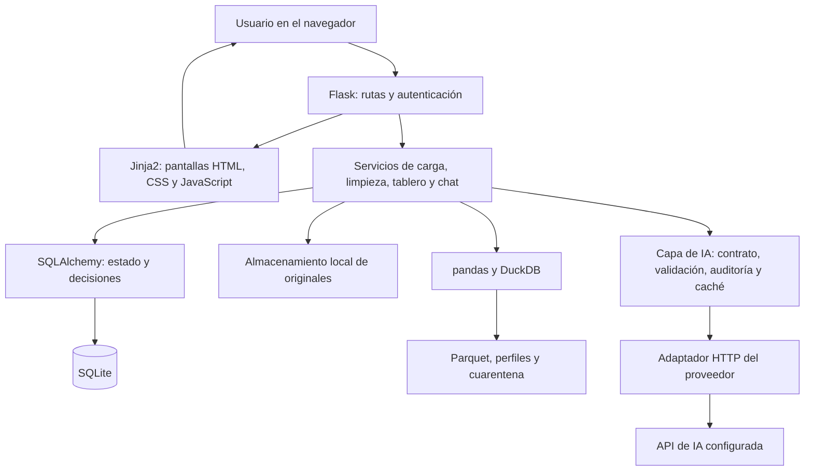
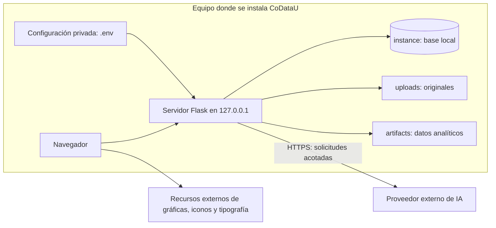
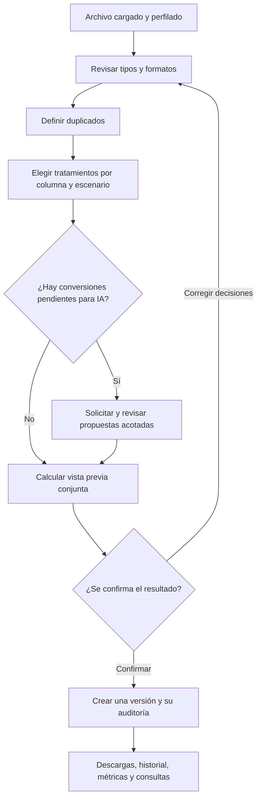
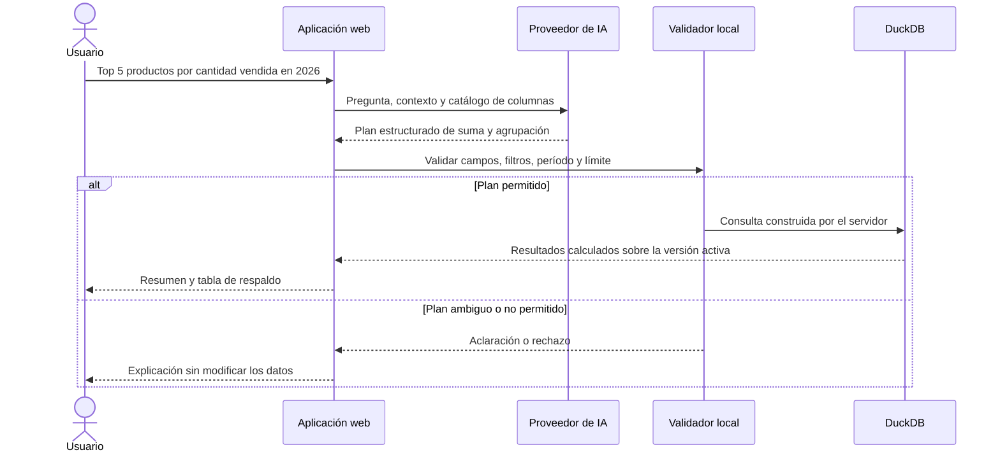
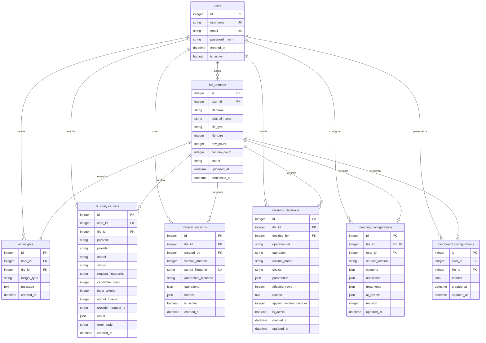

# 2.9. Informe técnico de CoDataU

- **Autor:** Kevin Santiago Sarmiento Rincón
- **Proyecto:** CoDataU
- **Corte:** cierre de desarrollo del MVP, 18 de octubre de 2026
- **Base de desarrollo:** `main`, commit `e16c522`
- **Repositorio:** [TheBlackFenix/codatau](https://github.com/TheBlackFenix/codatau)

## 1. Qué se construyó y por qué

La idea de CoDataU es ayudar a trabajar con archivos que llegan con formatos mezclados, datos incompletos o inconsistencias. Muchas veces la información sí existe, pero antes de analizarla hay que invertir bastante tiempo en ordenarla. Quise reunir ese trabajo en un recorrido que una persona pueda seguir sin escribir consultas ni programar transformaciones.

El proyecto permite cargar un CSV o Excel, entender su estructura, definir criterios de limpieza, revisar el efecto de esas decisiones y generar una nueva versión. Sobre el resultado se construyen métricas, gráficas y consultas en lenguaje natural.

La IA forma parte de ese recorrido, pero no es el motor de todas las operaciones. Una decisión importante fue resolver primero lo que se puede interpretar con reglas: fechas claras, formatos numéricos conocidos, espacios o equivalencias definidas por el usuario. Consultar un modelo para cada celda sería costoso y además haría más difícil explicar por qué cambió un dato.

El resultado es un MVP funcional de uso local. El cierre significa que el recorrido principal quedó implementado y probado, no que estén resueltos todos los escenarios de datos ni el despliegue público a gran escala.

## 2. Objetivos de esta versión

El objetivo principal es facilitar una preparación y consulta de datos con decisiones visibles, resultados verificables y posibilidad de volver a una versión anterior.

Para llegar a eso se trabajó en:

- Cargar y validar fuentes tabulares con mensajes que permitan corregir un problema de entrada.
- Separar el archivo original de sus versiones de trabajo.
- Guiar la configuración de tipos, duplicados y tratamientos de inconsistencias.
- Reducir consultas y revisiones de IA con reglas locales y decisiones por grupo.
- Mantener propuestas y cambios auditables, sin ejecutar código generado por un modelo.
- Mostrar métricas útiles en lugar de sumar cualquier columna que tenga dígitos.
- Permitir preguntas sobre la información activa y calcular las respuestas localmente.
- Agregar pruebas para el flujo normal, errores de entrada y restricciones de seguridad.

## 3. Alcance y límites

### Incluido

Registro y acceso; gestión de archivos propios; carga CSV, XLS y XLSX; perfil de calidad; contexto asistido por IA; selección de tipos; reglas numéricas, de fechas y texto; marcadores de ausencia; equivalencias por columna; duplicados configurables; tratamientos por escenario; propuestas de conversión con aprobación; vista previa; versiones y cuarentena; exportación; dashboard configurable; propuesta de métricas y chat de consulta.

Se conserva también el flujo de reglas individuales y manuales de limpieza. El asistente guiado es la entrada recomendada para realizar el proceso completo.

### No incluido

Carga de JSON, unión de archivos, conectores empresariales, tareas programadas de datos, predicciones, edición de datos desde el chat, ejecución de SQL libre o un catálogo general de cualquier regla de negocio. Tampoco se entrega infraestructura productiva, una aplicación de escritorio empaquetada ni una certificación de calidad total de datos.

No hay roles de administrador, colaboración simultánea entre varias cuentas sobre el mismo dataset, recuperación de contraseña por correo ni facturación integrada de IA.

## 4. Requisitos funcionales

| Código | Necesidad | Cómo quedó cubierta |
|---|---|---|
| RF-01 | Tener una cuenta y acceder a información propia | Registro, inicio y cierre de sesión, edición de nombre y cambio de contraseña. |
| RF-02 | Recibir archivos tabulares | CSV, XLS y XLSX con validación de extensión, lectura y tamaño. |
| RF-03 | Saber por qué una carga falla | Mensajes para archivo vacío, formato no legible y otros errores esperados. |
| RF-04 | Conocer la estructura y calidad inicial | Perfil con filas, columnas, tipos, nulos, cardinalidad, duplicados y muestra. |
| RF-05 | Obtener contexto del archivo | Análisis de encabezados y muestra acotada cuando la IA está configurada. |
| RF-06 | Elegir tipos comprensibles | Texto, identificador, entero, decimal, fecha, correo, teléfono y Sí/No. |
| RF-07 | Definir restricciones numéricas | Negativos permitidos o prohibidos y límites opcionales inclusivos. |
| RF-08 | Aclarar formatos de origen | Separadores numéricos e interpretación de fechas ambiguas. |
| RF-09 | Configurar vacíos y categorías | Marcadores por columna y diccionario explícito de equivalencias. |
| RF-10 | Definir qué es un duplicado | Toda la fila o campos elegidos; conservar primero, último o más reciente. |
| RF-11 | Decidir el tratamiento de inconsistencias | Conservar, vaciar, reemplazar, separar o aplicar conversiones permitidas por escenario. |
| RF-12 | Usar IA solo donde aporte | Propuestas acotadas para valores aptos, con aceptación o rechazo. |
| RF-13 | Ver el efecto antes de modificar | Vista previa conjunta con recuentos, ejemplos y advertencias. |
| RF-14 | Conservar trazabilidad y poder regresar | Versiones con configuración, operaciones y cambios; activación de versiones anteriores. |
| RF-15 | Recuperar resultados y filas apartadas | CSV de datos, cuarentena y paquete de calidad. |
| RF-16 | Elegir indicadores y mantenerlos | Tarjetas persistentes, agregar, quitar y reordenar por usuario y archivo. |
| RF-17 | Recibir una propuesta de tablero | Entre una y cinco métricas validadas, sin sustituir ajustes hasta aceptar. |
| RF-18 | Consultar en lenguaje natural | Totales, agrupaciones, rankings y comparación entre dos períodos. |
| RF-19 | Cambiar modelo para pruebas | Selector de sesión con catálogo de Google, sin reiniciar para cada elección. |

La presencia de un requisito no implica que cubra todas sus variantes posibles. Por ejemplo, validar un teléfono no significa validar todos los planes telefónicos del mundo, y reconocer fechas no significa interpretar cualquier representación escrita.

## 5. Requisitos no funcionales

| Área | Criterio aplicado | Alcance de la validación |
|---|---|---|
| Facilidad de uso | Lenguaje común, asistente por pasos, ayudas y controles que dependen de la decisión | Revisión de pantallas y pruebas de estructura; no hay estudio formal con una muestra de usuarios. |
| Integridad | No sobrescribir originales ni ejecutar una limpieza guiada sin confirmación | Pruebas de versiones, vista previa y cambios de estado. |
| Privacidad | Acceso por propietario y envío mínimo al proveedor | Validaciones de rutas y minimización; no equivale a anonimización irreversible. |
| Seguridad de consultas | Operaciones y campos permitidos, parámetros, sin SQL del modelo | Casos de consultas inválidas y filtros tratados como datos. |
| Trazabilidad | Guardar decisiones, modelo, versión y resultado | Modelos de auditoría y exportación de operaciones. |
| Mantenibilidad | Separar rutas, servicios, modelos y adaptadores | Organización modular y pruebas por servicio. |
| Portabilidad | Dependencias declaradas, configuración externa y migraciones | Instalación local y flujo automatizado definido para Python 3.13/3.14. |
| Uso responsable de IA | Muestras acotadas, caché, reglas locales y lotes pequeños | Comprobaciones con proveedores simulados y pruebas reales optativas. |
| Respuesta ante fallos | Conservar los datos y mostrar mensajes accionables | Pruebas de entradas inválidas, versiones antiguas y errores del proveedor. |
| Rendimiento | Parquet comprimido y procesamiento local con DuckDB | No hay un tiempo máximo certificado ni una prueba de carga multiusuario. |

## 6. Arquitectura general

La aplicación es un monolito modular: se ejecuta como un proyecto web, pero divide responsabilidades en capas. No utiliza microservicios ni necesita un servicio separado para el frontend.

Flask recibe las solicitudes. Las rutas comprueban sesión, propiedad del archivo y formularios; los servicios preparan o procesan datos; los modelos guardan el estado. Las pantallas se generan con plantillas Jinja2 y JavaScript se utiliza para interacciones puntuales y gráficas.

### Diagrama de componentes

Los diagramas están incluidos en formato Mermaid dentro del Markdown. Se pueden visualizar al abrir este documento en GitHub; un editor sin ese soporte puede mostrarlos como texto.

SQLite y los archivos cumplen funciones distintas. SQLite guarda quién es el usuario, qué archivo tiene, su configuración y las versiones existentes. Los registros completos de las tablas se guardan como archivos analíticos. Algunas decisiones, cambios y resultados de consulta sí pueden guardar valores dentro de la auditoría de SQLite.

### Dónde se ejecuta

La dirección local no permite por sí sola que otro equipo acceda a la aplicación. Los túneles usados en demostraciones fueron temporales y no forman parte del despliegue de entrega.

## 7. Pila tecnológica

Las versiones siguientes provienen de los archivos del proyecto; no se presentan como las últimas disponibles de cada tecnología.

| Componente | Tecnología de esta entrega | Responsabilidad |
|---|---|---|
| Lenguaje | Python; validación local con 3.14 | Lógica de la aplicación y procesamiento. |
| Web | Flask 3.1.0 | Solicitudes, sesiones, rutas y respuestas. |
| Plantillas | Jinja2, dependencia de Flask | Construcción de las pantallas en el servidor. No es React. |
| Interfaz | HTML, CSS propio y JavaScript | Formularios, asistente, ayudas, tablas y orden de tarjetas. |
| Gráficas | Chart.js 4.4.1 | Visualización temporal, categórica y de vacíos. |
| Datos tabulares | pandas 2.2.3 para Python menor a 3.14; 3.0.5 desde 3.14 | Lectura y preparación de tablas. |
| Motor analítico | DuckDB 1.5.5 | Perfilado, consultas y materialización de datos. |
| Formato de trabajo | Parquet con compresión Zstandard | Datos de cada versión y cuarentena. |
| Persistencia de aplicación | SQLite y SQLAlchemy 2.0.36; Flask-SQLAlchemy 3.1.1 | Cuentas, archivos, configuración y auditoría. |
| Migraciones | Flask-Migrate 4.1.0 y Alembic 1.20.0 | Evolución de tablas y columnas. |
| Acceso y formularios | Flask-Login 0.6.3 y Flask-WTF 1.2.2 | Sesión, formularios y protección CSRF. |
| Contraseñas | Werkzeug 3.1.3 | Hash y verificación, sin guardar contraseña en texto. |
| Excel | openpyxl 3.1.5 y xlrd 2.0.2 | Lectura de XLSX y XLS. |
| Reglas de números escritos | text2num 3.0.2 | Conversión controlada de enteros escritos en español. |
| IA | HTTP y contratos JSON, sin SDK específico obligatorio | Adaptadores Responses y Chat Completions compatible. |
| Pruebas | pytest 9.1.1 y ejecutor de pruebas de Node.js | Lógica, rutas, integraciones simuladas y presentación del chat. |
| Versionamiento | Git y GitHub | Trazabilidad de los cambios y cierre en `main`. |

No hay un proceso de compilación de React ni dependencias npm necesarias para iniciar la aplicación. La ausencia de React no impide una interfaz interactiva; las páginas y los cambios puntuales se resuelven con la estructura existente.

## 8. Recorrido técnico de los datos

### 8.1. Carga y preparación

Se guarda el original con un nombre único para evitar colisiones. El almacenamiento verifica que las rutas no salgan de su carpeta. La lectura valida contenido y produce mensajes esperados en lugar de una excepción genérica para el usuario.

CSV admite separadores y codificaciones habituales; Excel se lee desde su primera hoja. No se combinan libros ni archivos entre sí. La copia inicial retira filas y columnas totalmente nulas. En las cargas nuevas no se recorta texto silenciosamente: las reglas de texto se deciden en el asistente. Los textos literales `N/A` o `NULL` se conservan para que el usuario pueda definir su significado.

pandas prepara la tabla y DuckDB la materializa en Parquet. El perfil local calcula esquema, nulos, duplicados, cardinalidad y estadísticas, además de una muestra limitada. El perfil es un apoyo para diagnosticar; no reemplaza el conjunto completo al calcular resultados.

No se usa un archivo `.duckdb` compartido como base principal. Las conexiones analíticas se abren para las operaciones y los resultados persistentes quedan en archivos independientes.

### 8.2. Limpieza guiada

Los tipos se presentan en lenguaje común, pero internamente se conservan parámetros claros. Una columna numérica puede tener política de negativos, mínimo, máximo y formato de origen. Las fechas separan interpretación y presentación. Texto puede incluir reglas opcionales, marcadores de ausencia y equivalencias exactas.

Los escenarios se agrupan para evitar una decisión por fila cuando existe una regla reconocida. `dos` puede proponerse como `2`; una fecha ISO puede presentarse en día/mes/año; un grupo de negativos puede pasar a positivo únicamente por decisión explícita del usuario cuando ese tratamiento es válido.

No se asume que todo negativo está mal ni que todo código numérico se suma. Un rango inferido del contexto es orientativo; el límite elegido por el usuario prevalece. Tampoco se recortan valores al mínimo o máximo para hacerlos parecer válidos.

El ejecutor trabaja sobre una copia: primero separa las filas indicadas, después transforma celdas y finalmente resuelve duplicados sobre el resultado. Conserva filas con claves incompletas y protege grupos cuya fecha no permite elegir el registro más reciente.

La confirmación usa un token firmado que vincula propietario, archivo, versión de origen, revisión de configuración y huella del plan y del artefacto. Su vigencia es de 30 minutos. Antes de confirmar se vuelve a verificar el estado para rechazar una pestaña antigua o una configuración cambiada en otra ventana.

La aplicación activa una versión después de crear y perfilar sus archivos. Si falla la operación, revierte el estado de base de datos y retira los artefactos nuevos de esa solicitud. Esto reduce resultados a medias, aunque no convierte el sistema de archivos y SQLite en una transacción distribuida frente a cualquier caída abrupta del equipo.

### 8.3. Original, borrador y versión

Son tres cosas distintas:

- **Original:** archivo físico que se recibió y no se sobrescribe al limpiar.
- **Borrador:** preferencias guardadas para una versión de origen; todavía no cambia los registros.
- **Versión:** resultado confirmado, con configuración, operaciones, cambios y métricas.

Si se conserva un valor incompatible con el tipo elegido, no se reemplaza por vacío para forzar una conversión. Puede quedar una columna de texto con formatos mezclados, y se advierte. El nombre «datos limpios» en una exportación no promete que desaparezcan todas las inconsistencias que el usuario decidió mantener.

## 9. Integración de IA

### 9.1. Qué hace en cada momento

| Tarea | Información principal enviada | Resultado esperado |
|---|---|---|
| Contexto del archivo | Encabezados, perfil y hasta cinco muestras enmascaradas, con límites configurables | Dominio, descripción, roles y restricciones sugeridas. |
| Análisis de limpieza individual | Candidatos permitidos, estadísticas y pequeñas muestras enmascaradas | Recomendar aplicar, conservar o pedir una decisión humana, con parámetros válidos. |
| Propuestas de conversión del asistente | Valores distintos aptos y tipo objetivo; hasta ocho por consulta | Propuesta de sustitución segura o revisión humana, nunca una modificación directa. |
| Propuesta de dashboard | Contexto y catálogo de cálculos, sin filas de muestra | Entre una y cinco métricas con motivo. |
| Chat | Pregunta, contexto, catálogo de campos, rangos de fechas e historial breve | Un plan de cálculo o una pregunta de aclaración. |

En el asistente actual se reservan contactos, posibles identificadores, vacíos y problemas de rango sin evidencia para decisiones locales o manuales. No se pide al modelo que invente un correo válido, un teléfono real o una cantidad faltante.

### 9.2. Cómo se comunica

Cada tarea tiene instrucciones predefinidas, una versión de prompt y un esquema JSON de respuesta. Las instrucciones piden texto en español y establecen que los datos recibidos son información no confiable: una celda que contenga instrucciones no debe controlar el proceso.

La respuesta se valida contra las columnas, operaciones, tipos y parámetros permitidos. No se ejecutan fragmentos de Python o SQL generados por el modelo. Solicitar español reduce mezclas de idioma, pero no garantiza una traducción perfecta en todos los modelos.

La lógica depende de un contrato común. Los adaptadores actuales permiten Responses o Chat Completions compatible. Para otro proveedor compatible normalmente se cambian dirección, modelo y credencial; si su contrato es diferente, se implementa un adaptador. No se promete que cualquier servicio sea intercambiable sin comprobar su respuesta estructurada.

El selector consulta modelos de generación de texto de Google y conserva la elección en la sesión del usuario. No almacena una clave por cada usuario ni administra facturación individual.

### 9.3. Costo y reutilización

El procesamiento determinista ocurre localmente. Las respuestas válidas se pueden reutilizar cuando coinciden propósito, archivo, propietario, versión, contexto, modelo y demás componentes de la huella. Cambiar uno de esos elementos puede requerir una nueva consulta.

Los análisis registran modelo, proveedor, estado, tokens reportados y código de error. No hay todavía un presupuesto monetario por usuario, estimador de factura o control de gasto contratado con el proveedor.

En el último ajuste se reprodujo un fallo en el que el modelo agotaba la salida y devolvía JSON incompleto. Se agregó un único reintento ante esa señal explícita, con presupuesto inicial más el menor valor entre ese presupuesto y 4096 tokens. Una respuesta truncada no se ejecuta, aunque parte de su contenido parezca válida. Con el valor inicial de 1200, el segundo intento permite 2400; no son consultas ilimitadas. El uso informado de ambos intentos se suma cuando hay respuesta exitosa.

### 9.4. Ejemplo de consulta al chat

Se admiten suma, promedio, mínimo, máximo, conteo y valores únicos; agrupaciones por campo o tiempo; hasta cinco filtros simples; y comparación de dos períodos no superpuestos. Los intervalos incluyen el inicio y excluyen el final. Los rankings tienen límite validado entre 1 y 20.

Los filtros se parametrizan y los identificadores se citan. La conexión del chat deshabilita acceso externo y limita memoria a 256 MB y dos hilos; esos límites no representan un límite global de memoria de toda la aplicación. No hay SQL libre ni acceso del modelo a las carpetas del equipo.

La IA no calcula ni redacta una segunda respuesta con resultados enviados de vuelta al proveedor: el servidor construye el resultado a partir del cálculo local. El chat puede pedir aclaraciones cuando falta año o hay varias medidas de ventas. La interpretación lingüística sigue dependiendo del modelo; una consulta válida en estructura todavía debe revisarse para comprobar que responde lo que el usuario quería.

## 10. Modelo de datos

El archivo cargado funciona como la unidad de información que se configura y versiona. No hay una tabla adicional llamada `datasets`; esa responsabilidad la representa `file_uploads` junto con sus archivos analíticos.

### Diagrama de relaciones

### Para qué sirve cada tabla

| Tabla | Responsabilidad y reglas principales |
|---|---|
| `users` | Cuenta, correo único, nombre único y hash de contraseña. |
| `file_uploads` | Propietario, nombre original, nombre interno, estado y resumen de la carga. |
| `dataset_versions` | Versiones confirmadas, ubicación del resultado, cuarentena, operaciones y métricas. La combinación archivo/número de versión es única. |
| `cleaning_configurations` | Un borrador por archivo, asociado a propietario y versión de origen. La revisión controla cambios simultáneos. |
| `cleaning_decisions` | Decisiones persistentes del flujo individual. La combinación archivo/operación es única. La limpieza guiada registra además su instantánea en la versión. |
| `ai_insights` | Mensajes de hallazgos. El nombre histórico no significa que cada mensaje haya consumido una llamada a IA. |
| `ai_analysis_runs` | Ejecuciones de IA diferenciadas por propósito, estado, modelo, huella, uso informado y resultado. |
| `dashboard_configurations` | Lista ordenada de métricas por usuario y archivo; esa combinación es única. |

El diagrama muestra relaciones generales. En la interfaz el propietario del archivo determina quién puede configurarlo; no hay compartición entre usuarios. El modelo permite identificar al creador de una versión y al autor de una decisión. La versión activa se resuelve en la aplicación, no mediante una tabla separada.

### Archivos fuera de la base

| Ubicación | Qué guarda |
|---|---|
| `uploads/` | Originales con nombres internos únicos. |
| `artifacts/` | Parquet de trabajo y versiones, perfiles JSON y cuarentena cuando existe. |
| `instance/` | Base SQLite de la instalación de referencia. |
| `output/` | Evidencias temporales de pruebas y paquetes generados; no son datos necesarios para ejecutar. |

Estos directorios no se versionan como información real de usuarios. Para respaldar una instalación hay que conservar base y archivos del mismo momento. El ZIP de código no sustituye esa copia.

### Migraciones

Hay seis revisiones: adopción del esquema inicial; tablas de pipeline y auditoría; configuración de columnas; preferencias de duplicados; tratamientos; y revisión de propuestas. Se aplican mediante `flask db upgrade`. En el entorno de pruebas se permite crear un esquema efímero; fuera de él, el arranque no reemplaza las migraciones por una creación automática de tablas.

## 11. Dashboard y presentación de resultados

Se distingue una medida de un identificador. Los campos de negocio pueden sugerir sumas, mientras que documentos, teléfonos y códigos no se agregan aritméticamente de forma automática. El usuario puede elegir conteos, completitud o valores únicos cuando esa sea la pregunta correcta.

La configuración admite hasta 24 tarjetas y guarda columna, cálculo y orden por usuario y archivo. Agregar o quitar una métrica usa la misma cuadrícula; no crea un bloque separado. Si una nueva versión deja un cálculo incompatible, la aplicación no lo presenta como si siguiera siendo válido.

Las gráficas priorizan una serie temporal, agrupaciones categóricas acotadas y columnas con más nulos. No comparan deliberadamente medidas de unidades distintas como si fueran equivalentes. La granularidad temporal baja como máximo a una hora y, si no hay una medida adecuada, se usa cantidad de registros en lugar de inventar una suma.

Las tablas del chat utilizan encabezados, alineación numérica, separadores locales, fechas legibles y desplazamiento horizontal. Los detalles del cálculo permiten revisar el resultado sin llenar la respuesta principal de información técnica.

## 12. Seguridad y manejo de información

Las contraseñas se guardan mediante hash de Werkzeug, no en texto ni con un algoritmo propio. Las rutas protegidas exigen autenticación y se comprueba el propietario antes de consultar o transformar un archivo. Los formularios de operaciones sensibles incorporan protección CSRF.

La credencial de IA se lee desde el entorno; no se agrega a respuestas de la interfaz ni a los modelos de base de datos. `.env` queda fuera del control de versiones y del paquete de entrega. No se deben publicar capturas de credenciales ni respuestas de error sin revisar su contenido.

Los originales se guardan sin sobrescribirlos durante la limpieza. Esto no significa almacenamiento legalmente inmutable: el propietario puede eliminar un archivo y sus elementos asociados. La cuarentena es recuperable por descarga, pero la eliminación no tiene papelera.

El enmascaramiento reduce información enviada al proveedor, pero no se presenta como anonimización garantizada. Nombres de columnas, preguntas escritas por el usuario, contexto y algunas muestras pueden seguir revelando información. La auditoría local también puede guardar valores originales, propuestas y cambios, por lo que necesita la misma protección que los archivos.

No se implementó cifrado propio de base de datos o archivos en reposo, auditoría externa inalterable, análisis antivirus de cargas ni evaluación formal de cumplimiento normativo. Esas necesidades deben resolverse antes de usar información sensible en un entorno público.

## 13. Pruebas y verificación

### Estrategia

Se combinaron pruebas de servicios, rutas con cliente de Flask, persistencia, archivos temporales y proveedores simulados. La suite habitual no consume API. Las pruebas reales se habilitan de manera explícita con `RUN_LIVE_AI_TEST=1` y utilizan datos sintéticos.

El flujo de GitHub está configurado para Python 3.13 y 3.14: instala dependencias, compila fuentes, verifica migraciones y ejecuta pytest. La existencia de esa configuración no equivale a afirmar que se revisó el resultado remoto de cada ejecución.

### Cobertura por escenarios

| Área | Casos comprobados | Evidencia en el repositorio |
|---|---|---|
| Acceso y propiedad | Sesión, cuentas y acceso a archivos ajenos | `test_auth.py`, `test_files.py`, pruebas del chat y configuraciones. |
| Carga y almacenamiento | Archivos no legibles, rutas permitidas y persistencia de artefactos | `test_files.py`, `test_storage_service.py`, `test_dataset_pipeline.py`. |
| Tipos y duplicados | Preferencias, claves, conservación y fechas | `test_column_types.py`, `test_duplicate_configuration.py`. |
| Números y fechas | Negativos, rangos, separadores, palabras y ambigüedad | `test_numeric_bounds.py`, `test_numeric_normalization.py`, `test_date_normalization.py`. |
| Texto y categorías | Reglas optativas, marcadores y equivalencias exactas | `test_text_normalization.py`, `test_missing_markers.py`, `test_category_dictionary.py`. |
| Limpieza confirmada | Vista previa, conservación, cuarentena, revisiones antiguas y auditoría | `test_cleaning_executor.py`, `test_wizard_execution.py`. |
| IA | Contratos, caché, respuestas inválidas y selección de modelo | `test_ai_providers.py`, `test_ai_cleaning_service.py`, `test_ai_model_selection.py`. |
| Métricas y chat | Propuestas válidas, cálculos, filtros, períodos y ranking top 5 | `test_ai_dashboard_service.py`, `test_dataset_chat_service.py`. |
| Interfaz | Elementos del asistente y formato de respuestas del chat | `test_ux_shell.py`, `chat_presentation.test.cjs`. |
| Base de datos | Aplicación de revisiones y correspondencia con modelos | `test_migrations.py` y comandos de validación del esquema. |
| Paquete de entrega | Fuentes del commit, exclusión de datos locales, rechazo de archivos privados versionados y no sobrescritura | `test_delivery_package.py`. |

### Resultado del corte

En el cierre de desarrollo se verificaron **300 pruebas Python aprobadas**, con **6 pruebas reales de proveedor omitidas** en la ejecución normal, y **3 pruebas JavaScript aprobadas**. La validación de esta entrega documental se volvió a ejecutar y terminó con **307 pruebas Python aprobadas**, que incluyen **7 pruebas nuevas del empaquetador**, las mismas **6 pruebas de API omitidas** y **3 pruebas JavaScript aprobadas**.

También se ejecutó de forma explícita y satisfactoria una prueba real del ranking de cinco productos por unidades con el modelo que había presentado respuestas incompletas. No se ejecutaron simultáneamente todas las pruebas reales ni se infiere de esa prueba que todos los modelos del catálogo sean compatibles.

También se creó una base aislada con las seis migraciones y se comprobó que no hubiera cambios pendientes entre modelos y esquema. Se revisó la sintaxis de los tres scripts PowerShell y se verificó que el inicio rechazara un puerto de prueba ocupado sin detener el proceso que lo usaba. Los enlaces internos y los bloques de código de los documentos se comprobaron. No se hizo una instalación completa en un equipo nuevo: el instalador se entrega revisado en sintaxis y contra las dependencias existentes, no como un ensayo certificado en todos los sistemas.

Durante esa revisión, una ruta temporal demasiado larga en Windows hizo fallar pruebas de escritura. Se acortaron los nombres temporales del script de validación y la ejecución completa pasó. No se modificó la lógica de la aplicación para resolver ese problema de la herramienta de entrega.

Los comandos para repetir la validación están en el documento 2.7. Las pruebas no equivalen a un porcentaje de cobertura: no se midió ni se reporta uno.

### Pruebas pendientes fuera de este cierre

No hay pruebas de carga concurrente, estudio formal de usabilidad, matriz exhaustiva de navegadores y dispositivos, auditoría de accesibilidad completa, revisión de seguridad independiente ni recuperación ante caída física del equipo. La revisión visual y el diseño adaptable mejoran la experiencia, pero no sustituyen esas evaluaciones.

## 14. Límites conocidos y riesgos

| Límite o riesgo | Cómo se maneja hoy | Qué quedaría después |
|---|---|---|
| El modelo puede interpretar mal una pregunta | Plan acotado, aclaraciones y detalle del cálculo | Evaluaciones lingüísticas con más archivos y preguntas. |
| Muchas excepciones distintas siguen requiriendo revisión | Reglas locales, grupos y propuestas por valor repetido | Más reglas contextuales agrupadas, con cobertura y excepciones claras. |
| Archivo grande o varios usuarios pueden elevar memoria y espera | Límite de carga y operaciones acotadas | Trabajos en segundo plano y pruebas de capacidad. |
| Una medida puede quedar mezclada con texto conservado | Advertencia y restricción de cálculos incompatibles | Mejores vistas para separar calidad y análisis sin perder información. |
| Monedas y escalas no son un contrato financiero exacto | No se asume moneda ni se quitan símbolos arbitrariamente | Tipos monetarios, unidades y precisión fija explícitos. |
| Contexto o muestra puede contener información sensible | Minimización, enmascaramiento y advertencias | Política de consentimiento, retención y evaluación de privacidad. |
| El costo de API depende de uso y modelo | Caché, límites y solicitudes explícitas | Cuotas por usuario, estimación y supervisión de gasto. |
| Algunas fechas no tienen una conversión segura | No adivinar formatos ni fechas imposibles | Formatos adicionales con reglas verificables, no parsers indiscriminados. |
| Formato de fechas no uniforme en todas las pantallas | Se respeta la preferencia al convertir y exportar | Unificar la presentación analítica. |
| Dependencia de recursos externos de interfaz | Recursos definidos en las plantillas | Evaluar hospedarlos localmente para instalaciones sin internet. |

## 15. Entrega y continuidad

El cierre se integró a `main` mediante el commit `e16c522`, conservando los 16 commits que estaban pendientes en la rama de desarrollo. Eso mantiene la trazabilidad de las etapas y deja una base identificable para la documentación.

Los documentos y herramientas de entrega se guardan en `documentos/`. El empaquetador exporta una referencia concreta de Git, incorpora su commit en el ZIP y genera un comprobante SHA-256. No exporta claves, bases de trabajo, archivos subidos ni entorno virtual. El historial completo se consulta en el repositorio, no dentro del ZIP de fuentes.

Para continuar después del MVP priorizaría: validación con usuarios y archivos de varios contextos; nuevas reglas agrupadas que reduzcan aún más la revisión individual; control de costos; y preparación de una infraestructura pública segura. Las mejoras de precisión monetaria, relaciones entre campos, recetas compartidas y formatos adicionales deberían entrar como incrementos probados, no como inferencias silenciosas de IA.

## 16. Conclusión

CoDataU ya permite recorrer la carga, configuración, limpieza, versionamiento y análisis dentro de una misma aplicación. Lo más importante del resultado no es solo transformar archivos: es que una persona pueda decidir qué cambiar y revisar qué pasó después.

La combinación de reglas locales e IA mantiene ese equilibrio. Las reglas resuelven lo repetible; el modelo ayuda con interpretación y propuestas; y las decisiones se materializan en versiones que se pueden consultar y recuperar. El siguiente trabajo debe fortalecer esa base sin convertir la IA en una caja negra que cambie datos porque sí.

## 17. Fuentes internas de esta documentación

El informe se elaboró contrastando la documentación con la implementación. Estas son las referencias principales para ampliar o verificar un punto:

- [Dependencias de la aplicación](../requirements.txt) y [de pruebas](../requirements-dev.txt).
- [Configuración real](../app/config.py) y [plantilla sin credenciales](../.env.example).
- [Modelos de datos](../app/models/) y [migraciones](../migrations/versions/).
- [Servicios de procesamiento e IA](../app/services/).
- [Contrato de la integración con IA](../docs/architecture/ai-integration.md).
- [Catálogo determinista](../docs/architecture/deterministic-rule-catalog.md).
- [Evolución del asistente de limpieza](../docs/architecture/cleaning-wizard.md).
- [Configuración del dashboard](../docs/architecture/dashboard-configuration.md).
- [Pruebas automatizadas](../tests/) y [flujo de validación de GitHub](../.github/workflows/ci.yml).

Algunas notas de arquitectura conservan la historia de etapas anteriores. Cuando describen trabajo «siguiente» o «pendiente», hay que contrastarlo con los incrementos posteriores y con el código del corte, no asumir que todo ese historial es una descripción única del estado final.
