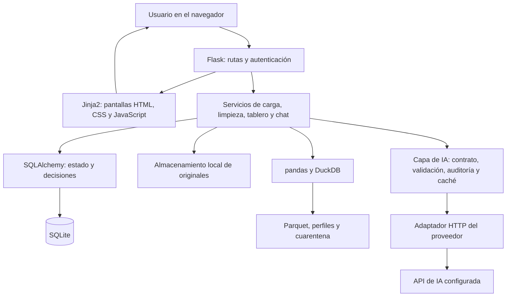
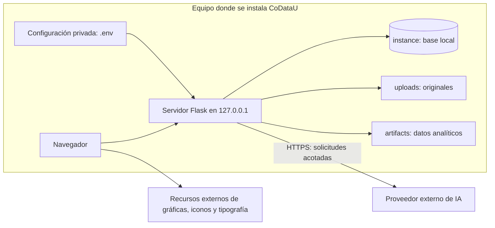
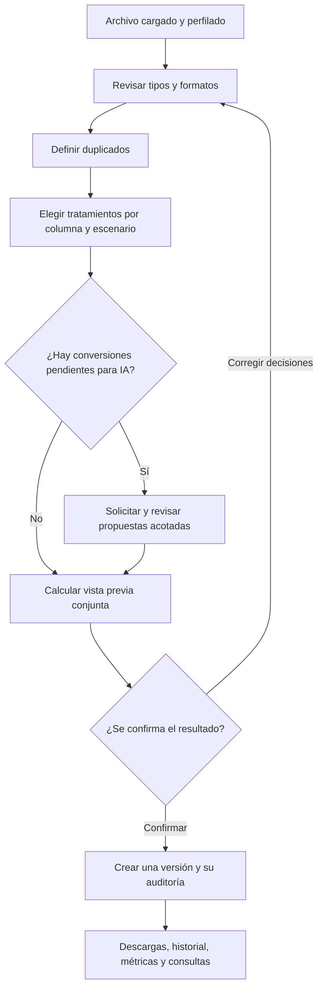
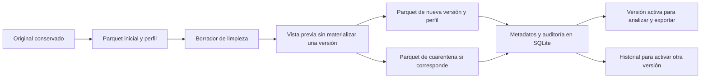
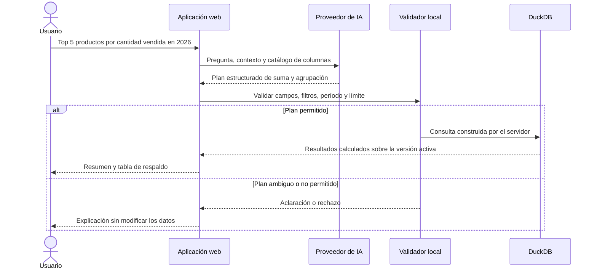

# 2.9. Informe técnico de CoDataU

- **Autor:** Kevin Santiago Sarmiento Rincón
- **Proyecto:** CoDataU
- **Corte:** cierre de desarrollo del MVP, 18 de octubre de 2026
- **Base de desarrollo:** `main`, commit `e16c522`
- **Repositorio:** [TheBlackFenix/codatau](https://github.com/TheBlackFenix/codatau)

Este informe distingue lo que está implementado de las posibilidades de las tecnologías utilizadas. Las referencias **C** apuntan al código que permite comprobar el funcionamiento; las referencias **R** corresponden a documentación externa consultada, reunida al final. Los ejemplos de intercambio de datos son ilustrativos y no contienen información de usuarios.

## 1. Qué se construyó y por qué

La idea de CoDataU es ayudar a trabajar con archivos que llegan con formatos mezclados, datos incompletos o inconsistencias. Muchas veces la información sí existe, pero antes de analizarla hay que invertir bastante tiempo en ordenarla. Quise reunir ese trabajo en un recorrido que una persona pueda seguir sin escribir consultas ni programar transformaciones.

El proyecto permite cargar un CSV o Excel, entender su estructura, definir criterios de limpieza, revisar el efecto de esas decisiones y generar una nueva versión. Sobre el resultado se construyen métricas, gráficas y consultas en lenguaje natural.

La IA forma parte de ese recorrido, pero no es el motor de todas las operaciones. Una decisión importante fue resolver primero lo que se puede interpretar con reglas: fechas claras, formatos numéricos conocidos, espacios o equivalencias definidas por el usuario. Consultar un modelo para cada celda sería costoso y además haría más difícil explicar por qué cambió un dato.

El resultado es un MVP funcional de uso local. El cierre significa que el recorrido principal quedó implementado y probado, no que estén resueltos todos los escenarios de datos ni el despliegue público a gran escala.

## 2. Objetivos de esta versión

El objetivo principal es facilitar una preparación y consulta de datos con decisiones visibles, resultados verificables y posibilidad de volver a una versión anterior.

Para llegar a eso se trabajó en:

- Cargar y validar fuentes tabulares con mensajes que permitan corregir un problema de entrada.
- Separar el archivo original de sus versiones de trabajo.
- Guiar la configuración de tipos, duplicados y tratamientos de inconsistencias.
- Reducir consultas y revisiones de IA con reglas locales y decisiones por grupo.
- Mantener propuestas y cambios auditables, sin ejecutar código generado por un modelo.
- Mostrar métricas útiles en lugar de sumar cualquier columna que tenga dígitos.
- Permitir preguntas sobre la información activa y calcular las respuestas localmente.
- Agregar pruebas para el flujo normal, errores de entrada y restricciones de seguridad.

## 3. Alcance y límites

### Incluido

Registro y acceso; gestión de archivos propios; carga CSV, XLS y XLSX; perfil de calidad; contexto asistido por IA; selección de tipos; reglas numéricas, de fechas y texto; marcadores de ausencia; equivalencias por columna; duplicados configurables; tratamientos por escenario; propuestas de conversión con aprobación; vista previa; versiones y cuarentena; exportación; dashboard configurable; propuesta de métricas y chat de consulta.

Se conserva también el flujo de reglas individuales y manuales de limpieza. El asistente guiado es la entrada recomendada para realizar el proceso completo.

### No incluido

Carga de JSON, unión de archivos, conectores empresariales, tareas programadas de datos, predicciones, edición de datos desde el chat, ejecución de SQL libre o un catálogo general de cualquier regla de negocio. Tampoco se entrega infraestructura productiva, una aplicación de escritorio empaquetada ni una certificación de calidad total de datos.

No hay roles de administrador, colaboración simultánea entre varias cuentas sobre el mismo dataset, recuperación de contraseña por correo ni facturación integrada de IA.

## 4. Requisitos funcionales

| Código | Necesidad | Cómo quedó cubierta |
|---|---|---|
| RF-01 | Tener una cuenta y acceder a información propia | Registro, inicio y cierre de sesión, edición de nombre y cambio de contraseña. |
| RF-02 | Recibir archivos tabulares | CSV, XLS y XLSX con validación de extensión, lectura y tamaño. |
| RF-03 | Saber por qué una carga falla | Mensajes para archivo vacío, formato no legible y otros errores esperados. |
| RF-04 | Conocer la estructura y calidad inicial | Perfil con filas, columnas, tipos, nulos, cardinalidad, duplicados y muestra. |
| RF-05 | Obtener contexto del archivo | Análisis de encabezados y muestra acotada cuando la IA está configurada. |
| RF-06 | Elegir tipos comprensibles | Texto, identificador, entero, decimal, fecha, correo, teléfono y Sí/No. |
| RF-07 | Definir restricciones numéricas | Negativos permitidos o prohibidos y límites opcionales inclusivos. |
| RF-08 | Aclarar formatos de origen | Separadores numéricos e interpretación de fechas ambiguas. |
| RF-09 | Configurar vacíos y categorías | Marcadores por columna y diccionario explícito de equivalencias. |
| RF-10 | Definir qué es un duplicado | Toda la fila o campos elegidos; conservar primero, último o más reciente. |
| RF-11 | Decidir el tratamiento de inconsistencias | Conservar, vaciar, reemplazar, separar o aplicar conversiones permitidas por escenario. |
| RF-12 | Usar IA solo donde aporte | Propuestas acotadas para valores aptos, con aceptación o rechazo. |
| RF-13 | Ver el efecto antes de modificar | Vista previa conjunta con recuentos, ejemplos y advertencias. |
| RF-14 | Conservar trazabilidad y poder regresar | Versiones con configuración, operaciones y cambios; activación de versiones anteriores. |
| RF-15 | Recuperar resultados y filas apartadas | CSV de datos, cuarentena y paquete de calidad. |
| RF-16 | Elegir indicadores y mantenerlos | Tarjetas persistentes, agregar, quitar y reordenar por usuario y archivo. |
| RF-17 | Recibir una propuesta de tablero | Entre una y cinco métricas validadas, sin sustituir ajustes hasta aceptar. |
| RF-18 | Consultar en lenguaje natural | Totales, agrupaciones, rankings y comparación entre dos períodos. |
| RF-19 | Cambiar modelo para pruebas | Selector de sesión con catálogo de Google, sin reiniciar para cada elección. |

La presencia de un requisito no implica que cubra todas sus variantes posibles. Por ejemplo, validar un teléfono no significa validar todos los planes telefónicos del mundo, y reconocer fechas no significa interpretar cualquier representación escrita.

## 5. Requisitos no funcionales

| Área | Criterio aplicado | Alcance de la validación |
|---|---|---|
| Facilidad de uso | Lenguaje común, asistente por pasos, ayudas y controles que dependen de la decisión | Revisión de pantallas y pruebas de estructura; no hay estudio formal con una muestra de usuarios. |
| Integridad | No sobrescribir originales ni ejecutar una limpieza guiada sin confirmación | Pruebas de versiones, vista previa y cambios de estado. |
| Privacidad | Acceso por propietario y envío mínimo al proveedor | Validaciones de rutas y minimización; no equivale a anonimización irreversible. |
| Seguridad de consultas | Operaciones y campos permitidos, parámetros, sin SQL del modelo | Casos de consultas inválidas y filtros tratados como datos. |
| Trazabilidad | Guardar decisiones, modelo, versión y resultado | Modelos de auditoría y exportación de operaciones. |
| Mantenibilidad | Separar rutas, servicios, modelos y adaptadores | Organización modular y pruebas por servicio. |
| Portabilidad | Dependencias declaradas, configuración externa y migraciones | Instalación local y flujo automatizado definido para Python 3.13/3.14. |
| Uso responsable de IA | Muestras acotadas, caché, reglas locales y lotes pequeños | Comprobaciones con proveedores simulados y pruebas reales optativas. |
| Respuesta ante fallos | Conservar los datos y mostrar mensajes accionables | Pruebas de entradas inválidas, versiones antiguas y errores del proveedor. |
| Rendimiento | Parquet comprimido y procesamiento local con DuckDB | No hay un tiempo máximo certificado ni una prueba de carga multiusuario. |

## 6. Arquitectura general

La aplicación es un monolito modular: se ejecuta como un proyecto web, pero divide responsabilidades en capas. No utiliza microservicios ni necesita un servicio separado para el frontend.

Flask recibe las solicitudes. Las rutas comprueban sesión, propiedad del archivo y formularios; los servicios preparan o procesan datos; los modelos guardan el estado. Las pantallas se generan con plantillas Jinja2 y JavaScript se utiliza para interacciones puntuales y gráficas.

### Diagrama de componentes

Los diagramas están incluidos en formato Mermaid dentro del Markdown. Se pueden visualizar al abrir este documento en GitHub; un editor sin ese soporte puede mostrarlos como texto.



SQLite y los archivos cumplen funciones distintas. SQLite guarda quién es el usuario, qué archivo tiene, su configuración y las versiones existentes. Los registros completos de las tablas se guardan como archivos analíticos. Algunas decisiones, cambios y resultados de consulta sí pueden guardar valores dentro de la auditoría de SQLite.

### Dónde se ejecuta



La dirección local no permite por sí sola que otro equipo acceda a la aplicación. Los túneles usados en demostraciones fueron temporales y no forman parte del despliegue de entrega.

## 7. Pila tecnológica

Las versiones siguientes provienen de los archivos del proyecto; no se presentan como las últimas disponibles de cada tecnología.

| Componente | Tecnología de esta entrega | Responsabilidad |
|---|---|---|
| Lenguaje | Python; validación local con 3.14 | Lógica de la aplicación y procesamiento. |
| Web | Flask 3.1.0 | Solicitudes, sesiones, rutas y respuestas. |
| Plantillas | Jinja2, dependencia de Flask | Construcción de las pantallas en el servidor. No es React. |
| Interfaz | HTML, CSS propio y JavaScript | Formularios, asistente, ayudas, tablas y orden de tarjetas. |
| Gráficas | Chart.js 4.4.1 | Visualización temporal, categórica y de vacíos. |
| Datos tabulares | pandas 2.2.3 para Python menor a 3.14; 3.0.5 desde 3.14 | Lectura y preparación de tablas. |
| Motor analítico | DuckDB 1.5.5 | Perfilado, consultas y materialización de datos. |
| Formato de trabajo | Parquet con compresión Zstandard | Datos de cada versión y cuarentena. |
| Persistencia de aplicación | SQLite y SQLAlchemy 2.0.36; Flask-SQLAlchemy 3.1.1 | Cuentas, archivos, configuración y auditoría. |
| Migraciones | Flask-Migrate 4.1.0 y Alembic 1.20.0 | Evolución de tablas y columnas. |
| Acceso y formularios | Flask-Login 0.6.3 y Flask-WTF 1.2.2 | Sesión, formularios y protección CSRF. |
| Contraseñas | Werkzeug 3.1.3 | Hash y verificación, sin guardar contraseña en texto. |
| Excel | openpyxl 3.1.5 y xlrd 2.0.2 | Lectura de XLSX y XLS. |
| Reglas de números escritos | text2num 3.0.2 | Conversión controlada de enteros escritos en español. |
| IA | HTTP y contratos JSON, sin SDK específico obligatorio | Adaptadores Responses y Chat Completions compatible. |
| Pruebas | pytest 9.1.1 y ejecutor de pruebas de Node.js | Lógica, rutas, integraciones simuladas y presentación del chat. |
| Versionamiento | Git y GitHub | Trazabilidad de los cambios y cierre en `main`. |

No hay un proceso de compilación de React ni dependencias npm necesarias para iniciar la aplicación. La ausencia de React no impide una interfaz interactiva; las páginas y los cambios puntuales se resuelven con la estructura existente.

## 8. Recorrido técnico de los datos

### 8.1. Carga y preparación

Se guarda el original con un nombre único para evitar colisiones. El almacenamiento verifica que las rutas no salgan de su carpeta. La lectura valida contenido y produce mensajes esperados en lugar de una excepción genérica para el usuario.

CSV admite separadores y codificaciones habituales; Excel se lee desde su primera hoja. No se combinan libros ni archivos entre sí. La copia inicial retira filas y columnas totalmente nulas. En las cargas nuevas no se recorta texto silenciosamente: las reglas de texto se deciden en el asistente. Los textos literales `N/A` o `NULL` se conservan para que el usuario pueda definir su significado.

pandas prepara la tabla y DuckDB la materializa en Parquet. El perfil local calcula esquema, nulos, duplicados, cardinalidad y estadísticas, además de una muestra limitada. El perfil es un apoyo para diagnosticar; no reemplaza el conjunto completo al calcular resultados.

No se usa un archivo `.duckdb` compartido como base principal. Las conexiones analíticas se abren para las operaciones y los resultados persistentes quedan en archivos independientes.

### 8.2. Limpieza guiada



Los tipos se presentan en lenguaje común, pero internamente se conservan parámetros claros. Una columna numérica puede tener política de negativos, mínimo, máximo y formato de origen. Las fechas separan interpretación y presentación. Texto puede incluir reglas opcionales, marcadores de ausencia y equivalencias exactas.

Los escenarios se agrupan para evitar una decisión por fila cuando existe una regla reconocida. `dos` puede proponerse como `2`; una fecha ISO puede presentarse en día/mes/año; un grupo de negativos puede pasar a positivo únicamente por decisión explícita del usuario cuando ese tratamiento es válido. El alcance concreto de esas reglas está en [C13](../docs/architecture/deterministic-rule-catalog.md).

No se asume que todo negativo está mal ni que todo código numérico se suma. Un rango inferido del contexto es orientativo; el límite elegido por el usuario prevalece. Tampoco se recortan valores al mínimo o máximo para hacerlos parecer válidos.

El ejecutor trabaja sobre una copia: primero separa las filas indicadas, después transforma celdas y finalmente resuelve duplicados sobre el resultado. Conserva filas con claves incompletas y protege grupos cuya fecha no permite elegir el registro más reciente.

La confirmación usa un token firmado que vincula propietario, archivo, versión de origen, revisión de configuración y huella del plan y del artefacto. Su vigencia es de 30 minutos. Antes de confirmar se vuelve a verificar el estado para rechazar una pestaña antigua o una configuración cambiada en otra ventana.

La aplicación activa una versión después de crear y perfilar sus archivos. Si falla la operación, revierte el estado de base de datos y retira los artefactos nuevos de esa solicitud. Esto reduce resultados a medias, aunque no convierte el sistema de archivos y SQLite en una transacción distribuida frente a cualquier caída abrupta del equipo.

### 8.3. Original, borrador y versión

Son tres cosas distintas:

- **Original:** archivo físico que se recibió y no se sobrescribe al limpiar.
- **Borrador:** preferencias guardadas para una versión de origen; todavía no cambia los registros.
- **Versión:** resultado confirmado, con configuración, operaciones, cambios y métricas.

Si se conserva un valor incompatible con el tipo elegido, no se reemplaza por vacío para forzar una conversión. Puede quedar una columna de texto con formatos mezclados, y se advierte. El nombre «datos limpios» en una exportación no promete que desaparezcan todas las inconsistencias que el usuario decidió mantener.

### 8.4. Por qué aparecen pandas, Parquet, DuckDB y SQLite en el mismo proceso

No se agregaron cuatro herramientas para hacer lo mismo. Cada una tiene una responsabilidad diferente:

| Elemento | Cómo lo uso en CoDataU | Qué no significa |
|---|---|---|
| pandas | Lee el CSV o Excel y permite trabajar con una tabla en memoria. El asistente también utiliza estas tablas para aplicar y comparar cambios. | No es un archivo de almacenamiento ni un servicio independiente. |
| Parquet | Conserva los registros de trabajo y de cada versión con tipos y compresión. | No es el original recibido ni una base de usuarios. |
| DuckDB | Lee esas tablas o archivos, calcula perfiles y consultas, y escribe resultados en Parquet. | No es el proveedor de IA ni necesita un servidor aparte en esta aplicación. |
| SQLite | Guarda cuentas, nombres y estados de archivos, configuraciones, versiones y auditoría. | No se usa como destino principal para cargar cada fila del CSV en una tabla relacional. |

Parquet es un formato orientado a columnas. Esto lo hace adecuado para información que después se va a consultar por campos, y permite compresión y codificación de los valores. No hay que confundir «columnar» con guardar cada columna en un archivo distinto: un Parquet puede contener toda la tabla. [R1](https://parquet.apache.org/docs/overview/)

En su estructura interna hay grupos de filas, fragmentos de columnas y páginas. La aplicación no administra esas partes manualmente; delega su escritura y lectura en DuckDB. Tampoco define en este MVP particiones por año, tamaño de grupo de filas ni una estrategia de índices sobre esos archivos. [R2](https://parquet.apache.org/docs/file-format/), [C1](../app/services/dataset_pipeline.py)

La elección evita tener que volver a interpretar el Excel en cada pantalla y separa el archivo entregado de una representación pensada para análisis. Eso es una decisión de diseño, no una afirmación de que cualquier archivo vaya a ocupar un porcentaje fijo menos o procesarse en un tiempo garantizado.

### 8.5. Qué pasa desde que llega un archivo hasta que existe su Parquet

El recorrido real es el siguiente:

1. La ruta de carga valida el formulario y guarda el original mediante `LocalStorageService`, con un nombre interno único. El nombre que ve el usuario queda registrado por separado.
2. `DataService` lee el contenido con pandas. Para CSV controla separadores, codificaciones y valores ausentes; para Excel utiliza el lector correspondiente a XLS o XLSX. La primera hoja es la que se recibe como tabla. Las opciones `keep_default_na=False` y el tratamiento de celdas vacías evitan perder textos como `NA` por una conversión predeterminada. [R7](https://pandas.pydata.org/docs/reference/api/pandas.read_csv.html), [R8](https://pandas.pydata.org/docs/reference/api/pandas.read_excel.html)
3. Se valida la estructura y se prepara la tabla sin retirar silenciosamente los espacios de los textos en cargas nuevas. Las filas y columnas completamente vacías sí pueden salir de la copia de trabajo.
4. `DatasetPipeline.ingest_dataframe` abre una conexión de DuckDB, crea una relación desde el dataframe con `from_df` y escribe mediante `write_parquet`, usando `compression='zstd'`.
5. En la carga inicial se escribe primero un archivo temporal en la misma carpeta y se publica con `os.replace`. El perfil JSON también se escribe mediante un temporal. El reemplazo de un archivo no debe confundirse con una transacción que cubra automáticamente todos los archivos y SQLite. [R14](https://docs.python.org/3/library/os.html#os.replace)
6. Se construye el perfil y se registra el archivo procesado en SQLite. Después se intenta obtener contexto con IA, si está configurada. Un fallo del proveedor no convierte una carga ya procesada en un archivo inválido.

El uso de `from_df`, `read_parquet` y `write_parquet` corresponde a la API relacional de DuckDB. Las relaciones permiten describir operaciones y ejecutarlas al solicitar sus resultados o materializarlas. En CoDataU esa capacidad se aprovecha en el perfilado, pero no significa que todas las rutas eviten cargar datos en memoria. [R4](https://duckdb.org/docs/current/clients/python/relational_api.html), [C1](../app/services/dataset_pipeline.py), [C2](../app/routes/files.py)

Por ejemplo, un original guardado como `uploads/abc123.csv` se asocia con:

```text
uploads/abc123.csv                         Original recibido
artifacts/abc123.parquet                   Tabla inicial preparada
artifacts/abc123.profile.json              Perfil de esa tabla

artifacts/abc123.wizard-<id>.parquet        Resultado de una limpieza confirmada
artifacts/abc123.wizard-<id>.profile.json   Perfil del resultado
artifacts/abc123.wizard-<id>.quarantine.parquet
                                          Filas separadas, si existen
```

Los nombres son un ejemplo; en la aplicación se generan identificadores únicos. Una clave de versión puede terminar internamente en `.csv` aunque el artefacto persistente correspondiente sea Parquet: `paths_for` toma la base del nombre y construye las rutas. Eso no implica que se haya guardado además una segunda copia física en CSV. El CSV para el usuario se genera al descargar. [C1](../app/services/dataset_pipeline.py), [C2](../app/routes/files.py)

### 8.6. Qué contiene el perfil y cómo se obtiene la muestra

El perfil `<nombre>.profile.json` es una descripción local del archivo, no una respuesta del proveedor. Incluye:

| Dato del perfil | Cómo se obtiene o para qué sirve |
|---|---|
| `profile_version` | Versión del contrato del perfil; permite identificar cuándo corresponde reconstruirlo. |
| Filas y columnas | Conteos del conjunto analítico completo. |
| Nulos y proporción por columna | Recuentos locales; la proporción se almacena redondeada a cuatro decimales. |
| `approx_unique` | Estimación de valores distintos con `approx_count_distinct`; no debe presentarse como un conteo exacto. |
| Mínimo, máximo y promedio numérico | Estadísticas de columnas físicamente numéricas. Que existan no obliga a tratarlas como medidas de negocio. |
| Semántica y evidencias | Inferencias locales de tipos y patrones realizadas por `SemanticProfiler`. |
| Duplicados iniciales | Diferencia entre filas totales y filas distintas considerando todos los campos. Es independiente de las claves de duplicados que el usuario definirá después. |
| `sample` | Una muestra acotada para orientar la interfaz y construir solicitudes pequeñas. |
| `cleaning_plan` | Operaciones conocidas y su nivel de revisión; no es código generado por IA. |
| `source_sha256` | Huella del original entregado como fuente al perfilador. En perfiles de versiones sigue vinculando el resultado con ese original. |

Con la configuración de referencia, `PROFILE_SAMPLE_SIZE=12`. Si el archivo no supera ese tamaño, se toma hasta esa cantidad; si lo supera, se utiliza `USING SAMPLE reservoir(12 ROWS) REPEATABLE (42)`. Por tanto, **la muestra no tiene que ser las primeras doce filas**, y las cinco entradas usadas para contexto tampoco tienen que ser los primeros cinco registros del archivo original. [C1](../app/services/dataset_pipeline.py)

La semilla busca facilitar la repetición del muestreo, pero no hay que prometer una muestra idéntica bajo cualquier condición. DuckDB advierte que con varios hilos puede variar incluso con semilla. El perfil ya guardado permite reutilizar la muestra concreta que se obtuvo, sin volver a seleccionarla en cada consulta. Una muestra pequeña tampoco garantiza incluir una anomalía poco frecuente; por eso los recuentos de calidad se calculan sobre el conjunto, no se extrapolan desde esas filas. [R6](https://duckdb.org/docs/current/sql/samples.html)

Conviene distinguir tres huellas: `source_sha256` identifica el original; el hash del Parquet que protege la confirmación identifica la versión analítica que se va a transformar; y las huellas de caché identifican los componentes de una solicitud de IA. No son intercambiables ni son un mecanismo de cifrado. SHA-256 produce un resumen de los bytes de entrada; qué bytes se incluyen depende del uso que hace la aplicación. [R13](https://docs.python.org/3/library/hashlib.html), [C1](../app/services/dataset_pipeline.py), [C2](../app/routes/files.py)

### 8.7. Cómo se consulta después y hasta dónde llega la optimización

En una lectura normal, `load_dataframe` abre el Parquet con DuckDB y solicita `.df()`. Eso materializa los datos en un dataframe. `load_dataframe_or_source` usa ese artefacto cuando existe y conserva una alternativa de lectura desde el original para ciertos casos de compatibilidad. La alternativa no representa una restauración automática de cualquier versión derivada cuyo Parquet se haya perdido. [C1](../app/services/dataset_pipeline.py)

Es importante diferenciar lo que la tecnología permite de lo que se implementó:

- DuckDB puede leer solo las columnas necesarias de un Parquet y llevar filtros hasta su lector; cuando los metadatos lo permiten, puede omitir partes del archivo. También escribe Parquet con compresión Zstandard. Son capacidades documentadas de DuckDB. [R3](https://duckdb.org/docs/current/data/parquet/overview.html)
- El perfilador y el ejecutor de limpieza individual trabajan con relaciones o consultas sobre Parquet. Sin embargo, varias pantallas, las estadísticas del dashboard y la limpieza guiada parten de un dataframe materializado.
- El chat recibe ese dataframe, prepara fechas y registra una tabla temporal en su propia conexión DuckDB. La consulta se ejecuta localmente sobre esos datos, no sobre una tabla permanente compartida ni dentro del proveedor.

No afirmo, por tanto, que todo el MVP sea un procesamiento por bloques, sin copias o de memoria constante. Hay operaciones que leen el conjunto completo y generan copias para proteger el original. Llevar más agregaciones y proyecciones directamente al lector Parquet sería una mejora de rendimiento posterior. [C1](../app/services/dataset_pipeline.py), [C7](../app/services/wizard_execution_service.py), [C8](../app/services/cleaning_executor.py), [C9](../app/services/dataset_chat_service.py)

La separación en artefactos independientes evita basar el producto en un único archivo nativo `.duckdb` escrito por varios procesos web. No elimina todos los problemas de concurrencia: siguen existiendo la base de metadatos, el sistema de archivos y las confirmaciones simultáneas. La documentación de DuckDB distingue lectura, escritura e implicaciones de trabajar dentro de uno o varios procesos; no se incorporó un coordinador distribuido a CoDataU. [R5](https://duckdb.org/docs/current/connect/concurrency.html)

### 8.8. Cómo se crea y se recupera una versión con sus archivos

La limpieza guiada combina las decisiones con las reglas locales en `WizardExecutionService`. No traduce todas las transformaciones a SQL: trabaja sobre dataframes, protege las celdas conservadas, valida conversiones, registra diferencias y vuelve a evaluar duplicados después de los cambios. El flujo individual conserva su propio ejecutor controlado con DuckDB. [C7](../app/services/wizard_execution_service.py), [C8](../app/services/cleaning_executor.py)

Al confirmar el asistente se generan nombres únicos y se escriben los Parquet de resultado y, cuando corresponde, cuarentena. Se construye un perfil nuevo y se guarda `DatasetVersion` con número, creador, operaciones y métricas. La instantánea incluye tipos, reglas, equivalencias, tratamientos, propuestas aceptadas y cambios por celda. La versión se activa al finalizar la operación de base de datos; los errores capturados revierten el estado y limpian los artefactos nuevos de esa solicitud. [C2](../app/routes/files.py)



Activar una versión anterior cambia la referencia activa y sus recuentos; no reconstruye toda la historia ni borra las posteriores. La opción original vuelve a la representación inicial procesada, no a prometer que una lectura de Excel recuperará cualquier información perdida antes de cargarlo. Para las descargas se lee la versión elegida y se construye el CSV, aplicando las preferencias de fecha de esa versión. La cuarentena conserva los registros apartados y su motivo, no una corrección inventada. [C2](../app/routes/files.py), [C16](../app/services/cleaning_export_service.py)

Esta organización exige respaldar SQLite, originales y artefactos como un conjunto. Un perfil JSON sin su Parquet no alcanza para reconstruir los registros; el original por sí solo tampoco contiene todas las decisiones y versiones posteriores.

## 9. Integración de IA

### 9.1. Qué hace en cada momento

| Tarea | Información principal enviada | Resultado esperado |
|---|---|---|
| Contexto del archivo | Encabezados, perfil y hasta cinco muestras enmascaradas, con límites configurables | Dominio, descripción, roles y restricciones sugeridas. |
| Análisis de limpieza individual | Candidatos permitidos, estadísticas y pequeñas muestras enmascaradas | Recomendar aplicar, conservar o pedir una decisión humana, con parámetros válidos. |
| Propuestas de conversión del asistente | Valores distintos aptos y tipo objetivo; hasta ocho por consulta | Propuesta de sustitución segura o revisión humana, nunca una modificación directa. |
| Propuesta de dashboard | Contexto y catálogo de cálculos, sin filas de muestra | Entre una y cinco métricas con motivo. |
| Chat | Pregunta, contexto, catálogo de campos, rangos de fechas e historial breve | Un plan de cálculo o una pregunta de aclaración. |

En el asistente actual se reservan contactos, posibles identificadores, vacíos y problemas de rango sin evidencia para decisiones locales o manuales. No se pide al modelo que invente un correo válido, un teléfono real o una cantidad faltante.

### 9.2. Cómo se comunica

Cada tarea tiene instrucciones predefinidas, una versión de prompt y un esquema JSON de respuesta. Las instrucciones piden texto en español y establecen que los datos recibidos son información no confiable: una celda que contenga instrucciones no debe controlar el proceso.

La respuesta se valida contra las columnas, operaciones, tipos y parámetros permitidos. No se ejecutan fragmentos de Python o SQL generados por el modelo. Solicitar español reduce mezclas de idioma, pero no garantiza una traducción perfecta en todos los modelos.

La lógica depende de un contrato común. Los adaptadores actuales permiten Responses o Chat Completions compatible. Para otro proveedor compatible normalmente se cambian dirección, modelo y credencial; si su contrato es diferente, se implementa un adaptador. No se promete que cualquier servicio sea intercambiable sin comprobar su respuesta estructurada.

El selector consulta modelos de generación de texto de Google y conserva la elección en la sesión del usuario. No almacena una clave por cada usuario ni administra facturación individual.

### 9.3. Costo y reutilización

El procesamiento determinista ocurre localmente. Las respuestas válidas se reutilizan mediante huellas y consultas acotadas al propietario y al archivo. No todas las tareas usan la misma huella: las propuestas y consultas se vinculan a la versión activa y su contenido de solicitud, mientras que el contexto general puede reutilizarse entre versiones del mismo archivo que conservan el esquema analizado. La sección 9.7 detalla esa diferencia y sus límites.

Los análisis registran modelo, proveedor, estado, tokens reportados y código de error. No hay todavía un presupuesto monetario por usuario, estimador de factura o control de gasto contratado con el proveedor.

En el último ajuste se reprodujo un fallo en el que el modelo agotaba la salida y devolvía JSON incompleto. Se agregó un único reintento ante esa señal explícita, con presupuesto inicial más el menor valor entre ese presupuesto y 4096 tokens. Una respuesta truncada no se ejecuta, aunque parte de su contenido parezca válida. Con el valor inicial de 1200, el segundo intento permite 2400; no son consultas ilimitadas. El uso informado de ambos intentos se suma cuando hay respuesta exitosa.

### 9.4. Ejemplo de consulta al chat



Se admiten suma, promedio, mínimo, máximo, conteo y valores únicos; agrupaciones por campo o tiempo; hasta cinco filtros simples; y comparación de dos períodos no superpuestos. Los intervalos incluyen el inicio y excluyen el final. Los rankings tienen límite validado entre 1 y 20.

Los filtros se parametrizan y los identificadores se citan. La conexión del chat deshabilita acceso externo y limita memoria a 256 MB y dos hilos; esos límites no representan un límite global de memoria de toda la aplicación. No hay SQL libre ni acceso del modelo a las carpetas del equipo.

La IA no calcula ni redacta una segunda respuesta con resultados enviados de vuelta al proveedor: el servidor construye el resultado a partir del cálculo local. El chat puede pedir aclaraciones cuando falta año o hay varias medidas de ventas. La interpretación lingüística sigue dependiendo del modelo; una consulta válida en estructura todavía debe revisarse para comprobar que responde lo que el usuario quería.

### 9.5. Paso a paso: cómo se obtiene el contexto del archivo

El contexto busca responder qué representa el archivo y qué función tiene cada campo. No intenta describir todas las filas ni resolver en esa llamada cada problema de calidad. Su preparación y validación están en `DatasetContextService`. [C3](../app/services/dataset_context_service.py)

1. Se parte del perfil local, no del archivo CSV completo ni de un enlace público al original.
2. Se seleccionan como máximo las primeras 80 columnas del perfil, según `AI_CONTEXT_MAX_COLUMNS`. Si se omiten otras, se informa su cantidad. No hay en esta etapa una búsqueda automática de las 80 columnas más representativas.
3. De cada columna se envía nombre, tipo físico, tipo semántico local, confianza local, proporción de nulos y cardinalidad aproximada. Si es numérica, se pueden incluir mínimo, máximo y promedio.
4. Se toman hasta cinco entradas de la muestra ya guardada, según `AI_CONTEXT_SAMPLE_ROWS`. Las filas se convierten en listas asociadas a `sample_columns`, para no repetir todos los nombres de los campos en cada registro.
5. Se enmascaran valores reconocidos como contactos o identificadores y se recortan representaciones largas. El nombre de una columna sensible también sirve como señal: por ejemplo, una columna con el término `nombre` se trata con cuidado aunque su tipo local no haya sido reconocido.
6. Antes de llamar al proveedor se busca un contexto válido reutilizable. Solo si no existe, o si se solicita renovarlo, se construye la consulta externa.
7. La respuesta se valida y se guarda en `AIAnalysisRun` con propósito `dataset_context`. Si falla, se registra el estado o error que corresponda y el archivo sigue disponible.

Este es un ejemplo reducido del cuerpo de datos de esa tarea. Los valores son ficticios y solo se muestra una entrada de muestra para facilitar la lectura; las instrucciones y el esquema de respuesta se envían aparte:

```json
{
  "context_version": "1.2-es",
  "dataset": {
    "row_count": 1000,
    "column_count": 2,
    "headers": [
      {
        "name": "codigo_cliente",
        "physical_type": "VARCHAR",
        "semantic_type": "identifier",
        "semantic_confidence": 0.95,
        "null_ratio": 0.0,
        "approx_unique": 100
      },
      {
        "name": "cantidad",
        "physical_type": "VARCHAR",
        "semantic_type": "number",
        "semantic_confidence": 0.9,
        "null_ratio": 0.02,
        "approx_unique": 12
      }
    ],
    "sample_columns": ["codigo_cliente", "cantidad"],
    "sample_rows": [["<redacted:identifier:length=6>", "dos"]],
    "omitted_column_count": 0
  }
}
```

El enmascaramiento actual contempla correos, teléfonos, identificadores, nombres de campos asociados a datos personales y secuencias largas de dígitos. Se limitan nombres de encabezados a 160 caracteres y representaciones de muestra a 120. Son controles prácticos, no una garantía de que una descripción libre o un encabezado nunca revele información. Tampoco se debe asumir que truncar un texto equivale a anonimizarlo. [C3](../app/services/dataset_context_service.py)

Hay una limitación adicional: ese enmascaramiento se aplica a valores de muestra, no a todos los metadatos. Si una columna de identificadores está almacenada físicamente como número, sus estadísticas de mínimo o máximo pueden contener información sensible. El código actual no filtra esos agregados por rol antes de construir el contexto. Por eso no presento el envío como completamente anonimizado ni recomiendo utilizar información sensible sin revisar y endurecer antes esta parte. [C3](../app/services/dataset_context_service.py)

El contexto esperado tiene cuatro partes:

| Parte | Ejemplo de significado | Uso posterior |
|---|---|---|
| `domain` | Ventas, envíos u otro dominio justificable | Orientar consultas y propuestas, no fijar una verdad definitiva. |
| `description` | Explicación breve del contenido | Evitar reconstruir en cada tarea qué representa el archivo. |
| `confidence` | Confianza declarada por el modelo, entre 0 y 1 | Informar incertidumbre; no es una precisión calibrada con datos de prueba. |
| `column_roles` | Medida, identificador, fecha, contacto, categoría y otros roles permitidos | Distinguir campos cuantificables y sugerir restricciones conocidas. |

Cada rol conserva columna, descripción, posibilidad de agregación y restricciones sugeridas de un catálogo cerrado. El validador rechaza columnas inventadas, duplicadas, roles desconocidos o restricciones fuera de ese catálogo. Una sugerencia de no admitir negativos se utiliza como apoyo a la revisión, no como permiso para cambiar el signo de todos los valores. El código confirma localmente si una restricción soportada afecta registros y las elecciones explícitas del usuario prevalecen. [C3](../app/services/dataset_context_service.py), [C14](../app/services/semantic_constraint_service.py)

### 9.6. Qué se envía en las llamadas posteriores

El proveedor no conserva por iniciativa de CoDataU una «memoria del archivo». El contexto queda en la aplicación y cada tarea recibe solo la parte que necesita:

- **Limpieza individual:** dominio y descripción recortados, confianza y roles de las columnas candidatas; junto a cada operación se envían evidencias numéricas, parámetros permitidos y ejemplos enmascarados. No se reenvía todo el perfil. [C5](../app/services/ai_cleaning_service.py)
- **Conversiones del asistente:** dominio general, valores distintos aptos, frecuencia, identificador del caso y preferencias del tipo objetivo. No se repite la fila completa donde aparece el valor. Las fechas ambiguas ya se resuelven por reglas de grupo; no se mandan a IA para que adivine su orden. [C6](../app/services/value_proposal_service.py)
- **Propuesta de dashboard:** contexto, cantidad de filas y catálogo de columnas con los cálculos compatibles y completitud. No se envían las filas de muestra ni los resultados completos de las métricas. [C10](../app/services/ai_dashboard_service.py)
- **Chat:** pregunta, cantidad de filas, catálogo de campos y rangos de fecha, dominio y descripción. Para entender una continuación se incluyen como máximo tres preguntas y planes anteriores de la versión activa, no todo el historial ni las tablas de respuestas previas. [C9](../app/services/dataset_chat_service.py)

Esto es reutilización de contexto dentro de la aplicación, no entrenamiento de un modelo, indexación por embeddings o un sistema RAG. Tampoco se crea un agente con acceso al disco para que abra el archivo por su cuenta.

En la integración compatible utilizada con Google, el adaptador envía un `POST` a `chat/completions`, con modelo, un mensaje de instrucciones, un mensaje de datos serializados como JSON, formato de respuesta y límite de salida. La credencial viaja en la cabecera de autorización, no dentro de la muestra. Google documenta el endpoint compatible que permite adaptar dirección, clave y modelo; eso respalda la decisión de encapsular el transporte sin amarrar los servicios de negocio a un SDK concreto. [R9](https://ai.google.dev/gemini-api/docs/openai), [C11](../app/services/ai_providers/openai_compatible.py)

Los JSON de envío se serializan sin sangría ni espacios separadores innecesarios. Es una reducción del tamaño del mensaje, no una equivalencia exacta entre caracteres retirados y tokens ahorrados. Las instrucciones y el esquema de salida también forman parte del trabajo de la consulta; el costo no se puede estimar contando únicamente las celdas de ejemplo.

### 9.7. Dos formas de caché local, con reglas diferentes

Guardar un resultado no es suficiente: hay que definir cuándo sigue siendo válido. Para eso se calculan huellas y se buscan solo ejecuciones exitosas del archivo y propietario correspondientes.

| Caché | Qué participa en la huella | Cuándo puede reutilizarse |
|---|---|---|
| Contexto general del archivo | Versión del prompt, proveedor, modelo, endpoint y lista analizada de nombres y tipos físicos | Puede sobrevivir a cambios de valores o de versión analítica del mismo archivo si el esquema analizado sigue igual. |
| Tareas de `StructuredAIService` | Propósito, versión de prompt, versión activa, proveedor, modelo, endpoint y contenido del payload | Solo si coinciden los componentes de esa tarea. Incluye propuestas del asistente, dashboard y chat. |
| Análisis individual de limpieza | Versión del análisis, hash de la fuente, proveedor, modelo, endpoint y contexto de candidatos, incluida la versión de datos | Se reutiliza para los mismos casos y parámetros de análisis, no como una respuesta general para cualquier archivo. |

Las huellas se calculan sobre una representación JSON ordenada y compacta, mediante SHA-256. La búsqueda también filtra por usuario y archivo: dos usuarios con columnas iguales no comparten resultados por ese hecho. Un hash sirve como clave de identificación; no demuestra que una recomendación sea verdadera ni cifra su contenido. [C3](../app/services/dataset_context_service.py), [C4](../app/services/structured_ai_service.py), [C5](../app/services/ai_cleaning_service.py), [R13](https://docs.python.org/3/library/hashlib.html)

La caché de contexto es deliberadamente más estable: busca ahorrar el redescubrimiento del significado general al limpiar solo valores. **No incluye en su huella la muestra ni las estadísticas actualizadas.** Por tanto, no debe tratarse como un diagnóstico de calidad permanentemente actualizado. Si cambia el significado del archivo sin cambiar el esquema, puede quedar un contexto desactualizado y debe renovarse. Existe la opción de forzar el análisis; cambios fuera del subconjunto de columnas analizadas tampoco garantizan invalidar esta huella. [C3](../app/services/dataset_context_service.py), [C2](../app/routes/files.py)

En el chat, repetir exactamente una pregunta puede aprovechar la respuesta guardada cuando también coincide el historial breve y el resto del payload. No se promete caché por «preguntas parecidas»: una redacción distinta o una continuación diferente puede generar una llamada nueva. En propuestas, los cambios de preferencias y versiones de reglas invalidan lo pendiente para no aplicar una decisión a otro escenario. [C4](../app/services/structured_ai_service.py), [C6](../app/services/value_proposal_service.py), [C9](../app/services/dataset_chat_service.py)

Esto no es la misma función que la caché de contexto que ofrece el proveedor. Google documenta mecanismos propios para reutilizar entradas del modelo. CoDataU no administra objetos de caché del proveedor ni garantiza descuentos por coincidencias implícitas; su ahorro comprobable por caché local ocurre cuando puede responder sin realizar otra llamada. [R12](https://ai.google.dev/gemini-api/docs/caching)

### 9.8. Estrategias concretas para ahorrar tokens y reducir decisiones repetidas

El ahorro principal no consiste en redactar instrucciones cada vez más cortas, sino en evitar pedirle al modelo un trabajo que el programa ya sabe hacer.

| Estrategia implementada | Qué se evita | Qué se conserva como protección |
|---|---|---|
| Reglas numéricas y de fechas antes de IA | Consultar por texto numérico claro, enteros escritos reconocidos o fechas de orden inequívoco | No adivinar separadores ambiguos, fechas imposibles ni magnitudes. |
| Reglas opcionales de texto | Solicitar correcciones de espacios, controles seleccionados o mayúsculas | Elección explícita, ejemplos y conservación de tildes. |
| Rangos y política de negativos del usuario | Pedir al modelo que decida el signo correcto en cada fila | Restricción conocida y tratamientos de grupo; no cambiar un saldo negativo válido. |
| Equivalencias guardadas por columna | Redescubrir con IA nombres que el usuario ya decidió unificar | Coincidencia explícita; no agrupar por parecido. |
| Conteos y perfil local | Enviar filas para que el modelo cuente nulos, duplicados o calcule estadísticas | Los cálculos de calidad usan el conjunto completo. |
| Muestra pequeña para contexto | Subir un archivo completo para identificar su dominio | Límites y enmascaramiento; incertidumbre de la muestra visible. |
| Contexto persistido y reducido por tarea | Volver a explicar todas las columnas en todas las consultas | Uso consultivo y posibilidad de renovación. |
| Análisis individual solo de candidatos pendientes | Consultar operaciones ya decididas o que no necesitan IA | Identificadores de operación y parámetros permitidos. |
| Una propuesta por valor distinto y columna | Repetir la misma pregunta por cada fila que contiene el mismo valor | Frecuencia y correspondencia entre caso original y propuesta. |
| Lotes de hasta ocho valores aptos | Una llamada por cada celda o una solicitud descontroladamente grande | Revisión humana de cada propuesta del lote y validación del destino. |
| Resultados locales reutilizables | Pagar otra llamada para una tarea idéntica vigente | Aislamiento por usuario, archivo y huella. |
| Modelo propone un plan, programa calcula | Devolver los resultados al modelo para que haga cuentas o redacte otra vez | Operaciones acotadas y evidencia verificable. |
| Historial corto del chat | Enviar toda la conversación y todas sus tablas | Solo el contexto reciente necesario para una continuación. |
| Límite de salida y un solo reintento condicionado | Respuestas narrativas extensas o reintentos ilimitados | Rechazar truncamientos, sin reparar JSON incompleto para ejecutarlo. |

La implementación de estas reglas y límites se puede contrastar en el [catálogo determinista](../docs/architecture/deterministic-rule-catalog.md), en [C5](../app/services/ai_cleaning_service.py), [C6](../app/services/value_proposal_service.py) y [C15](../app/config.py).

Un ejemplo ayuda a explicar la diferencia sin inventar un porcentaje de ahorro: supongamos 1000 filas con 30 valores distintos pendientes para una columna. Si todos necesitaran IA y fueran aptos, la revisión por lotes admitiría hasta cuatro consultas de conversiones, en lugar de una por fila. Si las reglas locales resolvieran 28 de esos valores, quedarían dos para un solo lote. Aparte se cuentan contexto, métricas o chat cuando se soliciten. Es un ejemplo de cantidad de llamadas, **no una medición de tokens ni una prueba de rendimiento realizada con ese conjunto**.

Agrupar tampoco significa que cualquier decisión cubra todo el archivo. El caso se identifica por escenario, columna y valor; el mismo texto puede tener un significado distinto en otra columna. Las reglas de grupo resuelven patrones reconocidos, mientras que el resto de excepciones distintas todavía puede requerir varias decisiones. No se entrega un motor que invente y ejecute nuevas reglas arbitrarias de IA.

### 9.9. Límites de configuración y qué protegen realmente

| Configuración del corte | Valor de referencia | Interpretación |
|---|---|---|
| `PROFILE_SAMPLE_SIZE` | 12 | Filas máximas de la muestra local del perfil, no tamaño del conjunto de cálculo. |
| `AI_CONTEXT_SAMPLE_ROWS` | 5 | Entradas máximas de esa muestra para contexto. |
| `AI_CONTEXT_MAX_COLUMNS` | 80 | Encabezados máximos del contexto y columnas de sus ejemplos. |
| `AI_MAX_CANDIDATE_COLUMNS` | 8 | Columnas candidatas por análisis individual de limpieza; no es un límite general del chat. |
| `AI_SAMPLE_VALUES` | 4 | Cantidad de ejemplos distintos que se busca incluir por candidato en ese análisis individual. |
| `ValueProposalService.BATCH_SIZE` | 8 | Valores distintos aptos por consulta del asistente. Es una constante, no una variable de `.env`. |
| `AI_MAX_OUTPUT_TOKENS` | 1200 | Presupuesto inicial de salida enviado al adaptador. |
| `AI_TIMEOUT_SECONDS` | 30 | Tiempo configurado de espera por intento del transporte. No es un tiempo máximo certificado del proceso completo. |

La configuración limita filas, columnas, caracteres, lotes y salida, pero **no hay todavía un contador previo de tokens que rechace cualquier entrada demasiado grande**. Cinco filas con 80 campos pueden seguir formando un mensaje considerable, al que se suman metadatos, esquema e instrucciones. Tampoco se ha implementado recorte automático del catálogo del chat a los campos relevantes de una pregunta. [C3](../app/services/dataset_context_service.py), [C9](../app/services/dataset_chat_service.py), [C15](../app/config.py)

El selector de modelos permite probar alternativas sin cambiar el código de negocio. No selecciona automáticamente el más barato, no consulta tarifas y no modifica de manera dinámica el presupuesto de razonamiento de cada modelo. El transporte actual tampoco envía un parámetro de nivel de razonamiento. La compatibilidad y el comportamiento siguen dependiendo del modelo y de su API. [C11](../app/services/ai_providers/openai_compatible.py), [C12](../app/services/google_model_catalog.py)

### 9.10. Cómo se observa el consumo y qué falta medir

Los tokens son unidades de representación del modelo, no una correspondencia fija con filas, palabras o caracteres. La documentación de Google describe su conteo, la posibilidad de medir la entrada antes de consultar y la información de uso que puede devolver la API. CoDataU recoge los campos de entrada y salida que expone el adaptador compatible; no llama actualmente a un endpoint previo de conteo ni persiste un desglose completo de razonamiento o de caché del proveedor. [R11](https://ai.google.dev/gemini-api/docs/tokens), [C11](../app/services/ai_providers/openai_compatible.py)

Para cada ejecución se puede revisar propósito, modelo, estado y tokens informados cuando existen. No se debe convertir un campo ausente en «costo cero». En una respuesta exitosa después de un truncamiento se suma el uso reportado de los dos intentos. Si ambos fallan, queda el error de la ejecución, pero no se conserva hoy un desglose completo de su consumo: es una mejora pendiente de observabilidad. [C4](../app/services/structured_ai_service.py), [C11](../app/services/ai_providers/openai_compatible.py)

Una estimación técnica simplificada sería sumar tokens de entrada por su tarifa y tokens de salida por la suya, usando la unidad de facturación de cada proveedor. Para calcular una factura real habría que considerar también el modelo, posibles categorías de razonamiento, caché, nivel de cuenta y condiciones vigentes. El proyecto no trae esas tarifas ni un cálculo monetario validado.

Para medir el ahorro real propondría comparar un conjunto fijo de archivos y tareas: número de llamadas externas, reutilizaciones locales, tokens reportados, duración y calidad del resultado. En este cierre no se hizo esa comparación controlada, por lo que no atribuyo al sistema cifras como «ahorra el 90 %». La reducción de envíos y repeticiones está implementada; su efecto económico exacto queda por medir.

### 9.11. Validación, seguridad y límites del contexto

Usar JSON estructurado ayuda a recibir campos y tipos esperados, pero no demuestra que el significado de una respuesta sea correcto. Google indica que sus salidas estructuradas admiten un subconjunto de JSON Schema y que la aplicación debe validar los valores. Por eso CoDataU comprueba nombres, tipos, roles, parámetros, cantidades y reglas de negocio después de recibir el JSON. [R10](https://ai.google.dev/gemini-api/docs/structured-output)

En conversiones, una propuesta no puede cambiar libremente una magnitud ya interpretable, redondear una fracción para volverla entera ni introducir un valor que incumpla el tipo y límites elegidos. En el chat, un plan válido tampoco implica que la pregunta haya sido comprendida perfectamente: la evidencia del cálculo sigue siendo necesaria. [C6](../app/services/value_proposal_service.py), [C9](../app/services/dataset_chat_service.py)

Las instrucciones separan datos de reglas, piden ignorar órdenes contenidas en celdas y prohíben código o SQL del modelo. Eso se combina con validación local y capacidades restringidas. OWASP describe la inyección de instrucciones como un riesgo que requiere controles en varias capas; un aviso en el prompt no es una protección absoluta. [R15](https://cheatsheetseries.owasp.org/cheatsheets/LLM_Prompt_Injection_Prevention_Cheat_Sheet.html)

Hay otros límites que conviene dejar explícitos:

- Una muestra pequeña puede no representar todos los productos, fechas o condiciones del archivo. Las inferencias de dominio y restricciones son consultivas.
- Los encabezados y preguntas también pueden revelar información, incluso cuando algunos valores están enmascarados.
- El contexto general reutilizado puede quedar desactualizado si cambia el significado sin cambiar el esquema.
- No hay una memoria compartida entre cuentas ni una biblioteca que transfiera automáticamente a otro archivo lo aprendido de uno anterior.
- No hay actualmente acuerdos de privacidad, retención o entrenamiento del proveedor configurados por el código. Esas condiciones deben revisarse con el servicio y la cuenta elegidos antes de utilizar información sensible; el enmascaramiento local no las sustituye.
- El uso de un modelo más capaz no autoriza a omitir vista previa, validación o aceptación humana.

### 9.12. Cómo se relaciona todo en un caso completo

En un archivo de ventas o envíos, primero se conserva el original y se crea su Parquet. El perfil puede detectar tipos, nulos y formatos que necesitan revisión. A partir de una descripción pequeña se obtiene un contexto que distingue medidas, contactos e identificadores.

El usuario confirma los tipos y restricciones: por ejemplo, una cantidad entera y un rango de medidas. El programa propone convertir los números en texto reconocidos, resuelve fechas claras y reúne los negativos no permitidos o los correos inválidos en sus escenarios. Si una equivalencia está definida, no tiene que preguntársela otra vez al modelo.

Solo los casos aptos que se dejaron para IA pasan a propuestas por valor distinto. La aceptación no modifica todavía el Parquet. Al confirmar la vista previa se crea la nueva versión con sus cambios y, si corresponde, cuarentena. Después se envía a la IA el catálogo para sugerir métricas, no el nuevo archivo completo.

Finalmente, una pregunta como el top 5 por cantidad se interpreta con ese contexto y el catálogo de la versión activa. DuckDB calcula localmente; el navegador recibe el resumen y su tabla de respaldo. El contexto ayuda a entender, las reglas controlan cómo transformar, Parquet conserva versiones y la aplicación mantiene el registro de lo decidido. Ninguna de esas partes sustituye a las otras.

## 10. Modelo de datos

El archivo cargado funciona como la unidad de información que se configura y versiona. No hay una tabla adicional llamada `datasets`; esa responsabilidad la representa `file_uploads` junto con sus archivos analíticos.

### Diagrama de relaciones


### Para qué sirve cada tabla

| Tabla | Responsabilidad y reglas principales |
|---|---|
| `users` | Cuenta, correo único, nombre único y hash de contraseña. |
| `file_uploads` | Propietario, nombre original, nombre interno, estado y resumen de la carga. |
| `dataset_versions` | Versiones confirmadas, ubicación del resultado, cuarentena, operaciones y métricas. La combinación archivo/número de versión es única. |
| `cleaning_configurations` | Un borrador por archivo, asociado a propietario y versión de origen. La revisión controla cambios simultáneos. |
| `cleaning_decisions` | Decisiones persistentes del flujo individual. La combinación archivo/operación es única. La limpieza guiada registra además su instantánea en la versión. |
| `ai_insights` | Mensajes de hallazgos. El nombre histórico no significa que cada mensaje haya consumido una llamada a IA. |
| `ai_analysis_runs` | Ejecuciones de IA diferenciadas por propósito, estado, modelo, huella, uso informado y resultado. |
| `dashboard_configurations` | Lista ordenada de métricas por usuario y archivo; esa combinación es única. |

El diagrama muestra relaciones generales. En la interfaz el propietario del archivo determina quién puede configurarlo; no hay compartición entre usuarios. El modelo permite identificar al creador de una versión y al autor de una decisión. La versión activa se resuelve en la aplicación, no mediante una tabla separada.

### Archivos fuera de la base

| Ubicación | Qué guarda |
|---|---|
| `uploads/` | Originales con nombres internos únicos. |
| `artifacts/` | Parquet de trabajo y versiones, perfiles JSON y cuarentena cuando existe. |
| `instance/` | Base SQLite de la instalación de referencia. |
| `output/` | Evidencias temporales de pruebas y paquetes generados; no son datos necesarios para ejecutar. |

Estos directorios no se versionan como información real de usuarios. Para respaldar una instalación hay que conservar base y archivos del mismo momento. El ZIP de código no sustituye esa copia.

### Migraciones

Hay seis revisiones: adopción del esquema inicial; tablas de pipeline y auditoría; configuración de columnas; preferencias de duplicados; tratamientos; y revisión de propuestas. Se aplican mediante `flask db upgrade`. En el entorno de pruebas se permite crear un esquema efímero; fuera de él, el arranque no reemplaza las migraciones por una creación automática de tablas.

## 11. Dashboard y presentación de resultados

Se distingue una medida de un identificador. Los campos de negocio pueden sugerir sumas, mientras que documentos, teléfonos y códigos no se agregan aritméticamente de forma automática. El usuario puede elegir conteos, completitud o valores únicos cuando esa sea la pregunta correcta.

La configuración admite hasta 24 tarjetas y guarda columna, cálculo y orden por usuario y archivo. Agregar o quitar una métrica usa la misma cuadrícula; no crea un bloque separado. Si una nueva versión deja un cálculo incompatible, la aplicación no lo presenta como si siguiera siendo válido.

Las gráficas priorizan una serie temporal, agrupaciones categóricas acotadas y columnas con más nulos. No comparan deliberadamente medidas de unidades distintas como si fueran equivalentes. La granularidad temporal baja como máximo a una hora y, si no hay una medida adecuada, se usa cantidad de registros en lugar de inventar una suma.

Las tablas del chat utilizan encabezados, alineación numérica, separadores locales, fechas legibles y desplazamiento horizontal. Los detalles del cálculo permiten revisar el resultado sin llenar la respuesta principal de información técnica.

## 12. Seguridad y manejo de información

Las contraseñas se guardan mediante hash de Werkzeug, no en texto ni con un algoritmo propio. Las rutas protegidas exigen autenticación y se comprueba el propietario antes de consultar o transformar un archivo. Los formularios de operaciones sensibles incorporan protección CSRF.

La credencial de IA se lee desde el entorno; no se agrega a respuestas de la interfaz ni a los modelos de base de datos. `.env` queda fuera del control de versiones y del paquete de entrega. No se deben publicar capturas de credenciales ni respuestas de error sin revisar su contenido.

Los originales se guardan sin sobrescribirlos durante la limpieza. Esto no significa almacenamiento legalmente inmutable: el propietario puede eliminar un archivo y sus elementos asociados. La cuarentena es recuperable por descarga, pero la eliminación no tiene papelera.

El enmascaramiento reduce información enviada al proveedor, pero no se presenta como anonimización garantizada. Nombres de columnas, preguntas escritas por el usuario, contexto y algunas muestras pueden seguir revelando información. La auditoría local también puede guardar valores originales, propuestas y cambios, por lo que necesita la misma protección que los archivos.

No se implementó cifrado propio de base de datos o archivos en reposo, auditoría externa inalterable, análisis antivirus de cargas ni evaluación formal de cumplimiento normativo. Esas necesidades deben resolverse antes de usar información sensible en un entorno público.

## 13. Pruebas y verificación

### Estrategia

Se combinaron pruebas de servicios, rutas con cliente de Flask, persistencia, archivos temporales y proveedores simulados. La suite habitual no consume API. Las pruebas reales se habilitan de manera explícita con `RUN_LIVE_AI_TEST=1` y utilizan datos sintéticos.

El flujo de GitHub está configurado para Python 3.13 y 3.14: instala dependencias, compila fuentes, verifica migraciones y ejecuta pytest. La existencia de esa configuración no equivale a afirmar que se revisó el resultado remoto de cada ejecución.

### Cobertura por escenarios

| Área | Casos comprobados | Evidencia en el repositorio |
|---|---|---|
| Acceso y propiedad | Sesión, cuentas y acceso a archivos ajenos | `test_auth.py`, `test_files.py`, pruebas del chat y configuraciones. |
| Carga y almacenamiento | Archivos no legibles, rutas permitidas y persistencia de artefactos | `test_files.py`, `test_storage_service.py`, `test_dataset_pipeline.py`. |
| Tipos y duplicados | Preferencias, claves, conservación y fechas | `test_column_types.py`, `test_duplicate_configuration.py`. |
| Números y fechas | Negativos, rangos, separadores, palabras y ambigüedad | `test_numeric_bounds.py`, `test_numeric_normalization.py`, `test_date_normalization.py`. |
| Texto y categorías | Reglas optativas, marcadores y equivalencias exactas | `test_text_normalization.py`, `test_missing_markers.py`, `test_category_dictionary.py`. |
| Limpieza confirmada | Vista previa, conservación, cuarentena, revisiones antiguas y auditoría | `test_cleaning_executor.py`, `test_wizard_execution.py`. |
| IA | Contratos, caché, respuestas inválidas y selección de modelo | `test_ai_providers.py`, `test_ai_cleaning_service.py`, `test_ai_model_selection.py`. |
| Métricas y chat | Propuestas válidas, cálculos, filtros, períodos y ranking top 5 | `test_ai_dashboard_service.py`, `test_dataset_chat_service.py`. |
| Interfaz | Elementos del asistente y formato de respuestas del chat | `test_ux_shell.py`, `chat_presentation.test.cjs`. |
| Base de datos | Aplicación de revisiones y correspondencia con modelos | `test_migrations.py` y comandos de validación del esquema. |
| Paquete de entrega | Fuentes del commit, exclusión de datos locales, rechazo de archivos privados versionados y no sobrescritura | `test_delivery_package.py`. |

### Resultado del corte

En el cierre de desarrollo se verificaron **300 pruebas Python aprobadas**, con **6 pruebas reales de proveedor omitidas** en la ejecución normal, y **3 pruebas JavaScript aprobadas**. La validación de esta entrega documental se volvió a ejecutar y terminó con **307 pruebas Python aprobadas**, que incluyen **7 pruebas nuevas del empaquetador**, las mismas **6 pruebas de API omitidas** y **3 pruebas JavaScript aprobadas**.

También se ejecutó de forma explícita y satisfactoria una prueba real del ranking de cinco productos por unidades con el modelo que había presentado respuestas incompletas. No se ejecutaron simultáneamente todas las pruebas reales ni se infiere de esa prueba que todos los modelos del catálogo sean compatibles.

También se creó una base aislada con las seis migraciones y se comprobó que no hubiera cambios pendientes entre modelos y esquema. Se revisó la sintaxis de los tres scripts PowerShell y se verificó que el inicio rechazara un puerto de prueba ocupado sin detener el proceso que lo usaba. Los enlaces internos y los bloques de código de los documentos se comprobaron. No se hizo una instalación completa en un equipo nuevo: el instalador se entrega revisado en sintaxis y contra las dependencias existentes, no como un ensayo certificado en todos los sistemas.

Durante esa revisión, una ruta temporal demasiado larga en Windows hizo fallar pruebas de escritura. Se acortaron los nombres temporales del script de validación y la ejecución completa pasó. No se modificó la lógica de la aplicación para resolver ese problema de la herramienta de entrega.

Los comandos para repetir la validación están en el documento 2.7. Las pruebas no equivalen a un porcentaje de cobertura: no se midió ni se reporta uno.

Para esta ampliación del informe se repitieron **49 pruebas** de pipeline, contexto, propuestas, chat y adaptadores: todas aprobaron, sin llamadas a la API. No se cambió la lógica del producto ni se presenta esta ejecución parcial como una nueva corrida de toda la suite.

### Pruebas pendientes fuera de este cierre

No hay pruebas de carga concurrente, estudio formal de usabilidad, matriz exhaustiva de navegadores y dispositivos, auditoría de accesibilidad completa, revisión de seguridad independiente ni recuperación ante caída física del equipo. La revisión visual y el diseño adaptable mejoran la experiencia, pero no sustituyen esas evaluaciones.

## 14. Límites conocidos y riesgos

| Límite o riesgo | Cómo se maneja hoy | Qué quedaría después |
|---|---|---|
| El modelo puede interpretar mal una pregunta | Plan acotado, aclaraciones y detalle del cálculo | Evaluaciones lingüísticas con más archivos y preguntas. |
| Muchas excepciones distintas siguen requiriendo revisión | Reglas locales, grupos y propuestas por valor repetido | Más reglas contextuales agrupadas, con cobertura y excepciones claras. |
| Archivo grande o varios usuarios pueden elevar memoria y espera | Límite de carga y operaciones acotadas | Trabajos en segundo plano y pruebas de capacidad. |
| Una medida puede quedar mezclada con texto conservado | Advertencia y restricción de cálculos incompatibles | Mejores vistas para separar calidad y análisis sin perder información. |
| Monedas y escalas no son un contrato financiero exacto | No se asume moneda ni se quitan símbolos arbitrariamente | Tipos monetarios, unidades y precisión fija explícitos. |
| Contexto o muestra puede contener información sensible | Minimización, enmascaramiento y advertencias | Política de consentimiento, retención y evaluación de privacidad. |
| El costo de API depende de uso y modelo | Caché, límites y solicitudes explícitas | Cuotas por usuario, estimación y supervisión de gasto. |
| Algunas fechas no tienen una conversión segura | No adivinar formatos ni fechas imposibles | Formatos adicionales con reglas verificables, no parsers indiscriminados. |
| Formato de fechas no uniforme en todas las pantallas | Se respeta la preferencia al convertir y exportar | Unificar la presentación analítica. |
| Dependencia de recursos externos de interfaz | Recursos definidos en las plantillas | Evaluar hospedarlos localmente para instalaciones sin internet. |

## 15. Entrega y continuidad

El cierre se integró a `main` mediante el commit `e16c522`, conservando los 16 commits que estaban pendientes en la rama de desarrollo. Eso mantiene la trazabilidad de las etapas y deja una base identificable para la documentación.

Los documentos y herramientas de entrega se guardan en `documentos/`. El empaquetador exporta una referencia concreta de Git, incorpora su commit en el ZIP y genera un comprobante SHA-256. No exporta claves, bases de trabajo, archivos subidos ni entorno virtual. El historial completo se consulta en el repositorio, no dentro del ZIP de fuentes.

Para continuar después del MVP priorizaría: validación con usuarios y archivos de varios contextos; nuevas reglas agrupadas que reduzcan aún más la revisión individual; control de costos; y preparación de una infraestructura pública segura. Las mejoras de precisión monetaria, relaciones entre campos, recetas compartidas y formatos adicionales deberían entrar como incrementos probados, no como inferencias silenciosas de IA.

## 16. Conclusión

CoDataU ya permite recorrer la carga, configuración, limpieza, versionamiento y análisis dentro de una misma aplicación. Lo más importante del resultado no es solo transformar archivos: es que una persona pueda decidir qué cambiar y revisar qué pasó después.

La combinación de reglas locales e IA mantiene ese equilibrio. Las reglas resuelven lo repetible; el modelo ayuda con interpretación y propuestas; y las decisiones se materializan en versiones que se pueden consultar y recuperar. El siguiente trabajo debe fortalecer esa base sin convertir la IA en una caja negra que cambie datos porque sí.

## 17. Fuentes internas de esta documentación

El informe se elaboró contrastando la documentación con la implementación. Estas son las referencias principales para ampliar o verificar un punto:

- [Dependencias de la aplicación](../requirements.txt) y [de pruebas](../requirements-dev.txt).
- [Configuración real](../app/config.py) y [plantilla sin credenciales](../.env.example).
- [Modelos de datos](../app/models/) y [migraciones](../migrations/versions/).
- [Servicios de procesamiento e IA](../app/services/).
- [Contrato de la integración con IA](../docs/architecture/ai-integration.md).
- [Catálogo determinista](../docs/architecture/deterministic-rule-catalog.md).
- [Evolución del asistente de limpieza](../docs/architecture/cleaning-wizard.md).
- [Configuración del dashboard](../docs/architecture/dashboard-configuration.md).
- [Pruebas automatizadas](../tests/) y [flujo de validación de GitHub](../.github/workflows/ci.yml).

Algunas notas de arquitectura conservan la historia de etapas anteriores. Cuando describen trabajo «siguiente» o «pendiente», hay que contrastarlo con los incrementos posteriores y con el código del corte, no asumir que todo ese historial es una descripción única del estado final.

### Mapa de las referencias al código

Las referencias C permiten ir de la explicación a la implementación que se revisó. Los enlaces son relativos al repositorio para que funcionen tanto en GitHub como dentro de la entrega de fuentes.

| Referencia | Archivo o conjunto consultado | Qué se verificó allí |
|---|---|---|
| C1 | [dataset_pipeline.py](../app/services/dataset_pipeline.py) | Nombres de artefactos, escritura Zstandard, lectura materializada, perfil, muestra y huella del original. |
| C2 | [files.py](../app/routes/files.py) | Carga, análisis de contexto, confirmación firmada, creación, activación y descarga de versiones. |
| C3 | [dataset_context_service.py](../app/services/dataset_context_service.py) | Payload del contexto, límites, enmascaramiento, validación, caché por esquema y renovación forzada. |
| C4 | [structured_ai_service.py](../app/services/structured_ai_service.py) | Huella por tarea y versión activa, reutilización, estado y auditoría de IA. |
| C5 | [ai_cleaning_service.py](../app/services/ai_cleaning_service.py) | Candidatos pendientes, evidencias, muestras, contexto reducido y contrato del análisis individual. |
| C6 | [value_proposal_service.py](../app/services/value_proposal_service.py) | Agrupación por valor, filtro de candidatos seguros, lotes de ocho, huellas y validación de magnitudes. |
| C7 | [wizard_execution_service.py](../app/services/wizard_execution_service.py) | Ejecución sobre dataframes, conservación, cambios por celda, tipos mezclados y duplicados finales. |
| C8 | [cleaning_executor.py](../app/services/cleaning_executor.py) | Ejecución controlada del flujo individual y salida Parquet. |
| C9 | [dataset_chat_service.py](../app/services/dataset_chat_service.py) | Catálogo, historial breve, plan permitido, consultas locales, límites y evidencia. |
| C10 | [ai_dashboard_service.py](../app/services/ai_dashboard_service.py) y [dashboard_service.py](../app/services/dashboard_service.py) | Catálogo de métricas, datos enviados, validación y configuración de tarjetas. |
| C11 | [openai_compatible.py](../app/services/ai_providers/openai_compatible.py), [http.py](../app/services/ai_providers/http.py) y [base.py](../app/services/ai_providers/base.py) | Transporte JSON, cabeceras, límites, reintento acotado y campos de uso reportado. |
| C12 | [google_model_catalog.py](../app/services/google_model_catalog.py), [ai_settings.py](../app/routes/ai_settings.py) y [factory.py](../app/services/ai_providers/factory.py) | Catálogo Google, selección de sesión y creación del adaptador. |
| C13 | [Catálogo determinista](../docs/architecture/deterministic-rule-catalog.md) y [servicios de reglas](../app/services/) | Números, fechas, texto, marcadores y equivalencias antes de IA. |
| C14 | [semantic_constraint_service.py](../app/services/semantic_constraint_service.py) y [cleaning_treatment_service.py](../app/services/cleaning_treatment_service.py) | Restricciones consultivas, comprobación de afectados y tratamientos permitidos. |
| C15 | [config.py](../app/config.py) y [.env.example](../.env.example) | Valores de referencia y qué opciones pueden configurarse. |
| C16 | [cleaning_export_service.py](../app/services/cleaning_export_service.py) y [reports.py](../app/routes/reports.py) | Exportación, preferencias de la versión y paquete de calidad. |

Además de leer los servicios, se contrastaron las pruebas de [pipeline](../tests/test_dataset_pipeline.py), [contexto](../tests/test_dataset_context_service.py), [propuestas](../tests/test_value_proposals.py), [chat](../tests/test_dataset_chat_service.py) y [proveedores](../tests/test_ai_providers.py). Por ejemplo, la prueba de contexto verifica expresamente que cambien los valores sin invalidar su huella, pero que un cambio de tipo sí la invalide.

## 18. Referencias externas y enlaces consultados

**Fecha de consulta de esta ampliación:** 18 de octubre de 2026. Se consultaron fuentes oficiales de los proyectos y la guía especializada de OWASP. Las referencias describen las tecnologías; el mapa de código de la sección 17 respalda qué parte está implementada en CoDataU. Las páginas «current» o de versión general pueden evolucionar y no sustituyen las versiones fijadas en `requirements.txt`.

| Referencia | Fuente y enlace consultado | Para qué se utilizó |
|---|---|---|
| R1 | Apache Parquet. [Overview](https://parquet.apache.org/docs/overview/) | Naturaleza columnar, almacenamiento y compresión del formato. |
| R2 | Apache Parquet. [File Format](https://parquet.apache.org/docs/file-format/) | Organización en grupos de filas, fragmentos de columnas, páginas y metadatos. |
| R3 | DuckDB. [Reading and Writing Parquet Files](https://duckdb.org/docs/current/data/parquet/overview.html) | Lectura, escritura Zstandard, proyección de columnas y filtros hasta el lector. |
| R4 | DuckDB. [Relational API](https://duckdb.org/docs/current/clients/python/relational_api.html) | Relaciones desde dataframes o Parquet, evaluación diferida y materialización. |
| R5 | DuckDB. [Concurrency](https://duckdb.org/docs/current/connect/concurrency.html) | Diferencias entre lectura y escritura dentro de uno o varios procesos. |
| R6 | DuckDB. [Samples](https://duckdb.org/docs/current/sql/samples.html) | Muestreo reservoir, semilla y límites de repetibilidad con varios hilos. |
| R7 | pandas. [pandas.read_csv](https://pandas.pydata.org/docs/reference/api/pandas.read_csv.html) | Lectura de CSV, separadores y configuración de valores ausentes. |
| R8 | pandas. [pandas.read_excel](https://pandas.pydata.org/docs/reference/api/pandas.read_excel.html) | Hoja predeterminada, lectura Excel y tratamiento de valores ausentes. |
| R9 | Google AI for Developers. [OpenAI compatibility](https://ai.google.dev/gemini-api/docs/openai) | Endpoint compatible y separación de dirección, credencial y modelo. |
| R10 | Google AI for Developers. [Structured outputs](https://ai.google.dev/gemini-api/docs/structured-output) | JSON Schema soportado y necesidad de validar valores en la aplicación. |
| R11 | Google AI for Developers. [Understand and count tokens](https://ai.google.dev/gemini-api/docs/tokens) | Qué son tokens, conteo previo y observación de uso. |
| R12 | Google AI for Developers. [Context caching](https://ai.google.dev/gemini-api/docs/caching) | Diferenciar la caché del proveedor de la reutilización local implementada. |
| R13 | Python. [hashlib — Secure hashes and message digests](https://docs.python.org/3/library/hashlib.html) | Huellas SHA-256; diferencia entre resumen de entrada, validez semántica y cifrado. |
| R14 | Python. [os.replace](https://docs.python.org/3/library/os.html#os.replace) | Publicación de un temporal mediante reemplazo del archivo de destino y su alcance. |
| R15 | OWASP Cheat Sheet Series. [LLM Prompt Injection Prevention](https://cheatsheetseries.owasp.org/cheatsheets/LLM_Prompt_Injection_Prevention_Cheat_Sheet.html) | Separación de instrucciones y datos, validación y controles en varias capas. |

### Direcciones de acceso y redirecciones de DuckDB

Durante la consulta también se abrieron estas direcciones `stable`, que redirigieron a la documentación `current` citada arriba. Las dejo para conservar los enlaces de entrada efectivamente utilizados:

- R3: [stable/data/parquet/overview](https://duckdb.org/docs/stable/data/parquet/overview) → [current/data/parquet/overview](https://duckdb.org/docs/current/data/parquet/overview).
- R4: [stable/clients/python/relational_api](https://duckdb.org/docs/stable/clients/python/relational_api) → [current/clients/python/relational_api](https://duckdb.org/docs/current/clients/python/relational_api).
- R5: [stable/connect/concurrency](https://duckdb.org/docs/stable/connect/concurrency) → [current/connect/concurrency](https://duckdb.org/docs/current/connect/concurrency).
- R6: [stable/sql/samples](https://duckdb.org/docs/stable/sql/samples) → [current/sql/samples](https://duckdb.org/docs/current/sql/samples).

No se utilizaron blogs comerciales ni precios promocionales para afirmar rendimiento o ahorro. Cuando se habla de reducción de llamadas, se explica el mecanismo que está en el código; cualquier medición de costo o capacidad pendiente se identifica como trabajo futuro.
